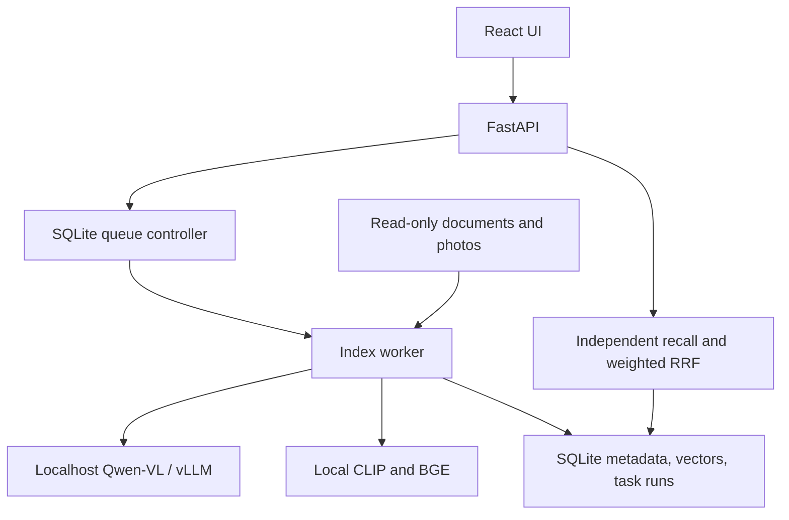

# Lentica

**Your photos and documents, searchable on your own machine.**

Lentica combines visual embeddings, structured image context, document evidence,
and an observable background queue in a local-first workspace. The name combines
*lens* and *semantic*. It grew out of Personal Knowledge Lab and currently ships
as an experimental, single-user application.

## Workspace

Lentica also hosts the related tools and learning projects in one spec-driven
repository. Runtime dependencies remain separate; installing the knowledge app
does not install a cloud CLI, desktop controller, GPU lab, or vLLM environment.

| Component | Path | Runtime |
| --- | --- | --- |
| Knowledge product | `backend/`, `frontend/` | Local FastAPI + React |
| Media generation | [apps/media-workflow](apps/media-workflow) | Explicit cloud Token Plan CLI |
| GUI agent example | [examples/multimodal-agent](examples/multimodal-agent) | Explicit image/screen API use and confirmed actions |
| Model serving | [services/vllm](services/vllm) | Separately provisioned vLLM/CUDA |
| GPU examples | [labs/gpu](labs/gpu) | Rust/wgpu, HIP, DirectML, CUDA |
| GPU-to-LLM lessons | [learning/gpu-llm](learning/gpu-llm) | Optional learning environment |

Start changes with [AGENTS.md](AGENTS.md), [workspace.toml](workspace.toml), and a
numbered [spec](specs/README.md). Scope/requirements, compatibility, acceptance
checks, and actual verification records travel with the implementation. The
knowledge backend stays local-only; remote media and GUI examples are explicit
opt-in components with independent configuration.

## What Works Today

- Photo search with CLIP image vectors and BGE text/context vectors, combined by
  weighted reciprocal rank fusion (RRF).
- Qwen-VL context extraction through a separately managed localhost vLLM service,
  with visible facts separated from model inferences.
- Read-only ingestion of TXT, Markdown, PDF, and DOCX; document search uses local
  TF-IDF and returns file/segment citations.
- SQLite jobs, incremental file hashing, run history, retries, and a Jobs UI with
  progress, timing, queue controls, and GPU status.
- Photo thumbnails, EXIF/time/GPS candidates, and opt-in face clustering with
  user-assigned names and aliases.
- React/TypeScript frontend: Chat, Library, Photos, People, Jobs, Models, Settings.

Vectors currently live in SQLite JSON columns and are scored in Python. Qdrant,
dedicated OCR, cross-encoder reranking, and Context Packs remain roadmap items.
Smoke/hash vectors exercise the pipeline only; they have no semantic meaning.

## Quick Start

Requirements: Python 3.11+ and Node.js 22.12+ (or 24+). Linux/WSL2 is the primary
development platform. A GPU is optional for document search and smoke mode.

```bash
git clone https://github.com/LiShuMing/lentica.git
cd lentica
# Activate an existing virtualenv, or create your preferred environment.
python -m pip install -e '.[dev]'
cp .env.example .env
```

Edit `.env` to choose your source directories. The example uses CPU smoke mode
and empty `library/documents` / `library/photos` directories. It does not scan
your home directory. Lentica never modifies source documents or photos.

Start the backend:

```bash
python -m uvicorn backend.app.main:app --env-file .env --host 127.0.0.1 --port 8000
```

In a second terminal:

```bash
cd frontend
npm ci
npm run dev -- --host 127.0.0.1 --port 5173
```

Open <http://127.0.0.1:5173>. API documentation is at
<http://127.0.0.1:8000/docs>. The backend starts the queue controller automatically;
the Jobs page can pause processing and adjust concurrency.

For the CPU-first example, select **Smoke: basic + hash** on the Photos page
before queuing or searching images. Document search requires no model setup.

## Semantic Photos

```bash
python -m pip install -e '.[models,heif]'
```

Provision CLIP and BGE model caches or set `LENTICA_CLIP_MODEL` and
`LENTICA_TEXT_MODEL` to local directories. Hugging Face loaders may download
weights when they are absent; set `HF_HUB_OFFLINE=1` after provisioning for offline
operation. User images are sent only to the configured loopback vision service.

Run Qwen-VL in a separate compatible vLLM environment. See
[model serving](docs/model-serving.md) for a reference command and GPU tradeoffs.
Set `LENTICA_WORKER_MODE=gpu` and the `LENTICA_VISION_*` settings. On a fresh data
directory these seed queue settings; later changes belong in the Jobs UI or
`data/queue_settings.json`. Use GPU/hybrid mode in Photos for semantic search.

No proprietary model weights, private photos, embeddings, databases, logs, or
credentials are distributed. Face indexing is off unless
`LENTICA_ENABLE_FACES=true`; review the model terms before installing `.[faces]`.

## Architecture



Qwen-VL gathers context during indexing; it is not called for each search.
CLIP queries compare against CLIP vectors, and BGE queries against BGE vectors.
RRF combines rankings without adding incompatible raw cosine scores.

## Development

```bash
python -m pytest
python scripts/check_workspace.py
ruff check backend scripts tests apps examples services labs learning
python -m build
cd frontend && npm run build
```

Tests use temporary databases, mocked transports, and synthetic files; they require no GPU, model
downloads, or access to personal libraries. CI tests Python 3.11/3.12 and builds
the frontend. Optional cloud/GUI/GPU work is not executed by CI. GPU/model quality and retrieval benchmarks need separate local
evaluation; no accuracy or latency gains are claimed by these smoke tests.

The existing `backend.app.*` module namespace and API routes are retained to keep
the migration narrow. See [architecture](docs/architecture.md),
[configuration](docs/configuration.md), [migration](docs/migration.md),
[contributing](CONTRIBUTING.md), and [third-party notices](THIRD_PARTY_NOTICES.md).

## License

Lentica source is licensed under [AGPL-3.0-only](LICENSE). Dependencies and model
weights retain their own licenses. In particular, InsightFace's distributed
pretrained weights have restrictions distinct from its code license.
