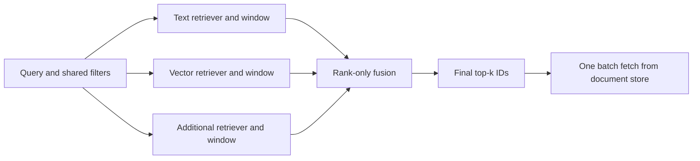

# Lentica Hybrid Search

An application-independent ranked retrieval layer. It is shipped in the backend
distribution but imports only standard-library modules at its core. Database
entities, settings and model runtimes do not enter its contracts or fusion logic.
See [spec 0003](../../../../specs/0003-hybrid-search-layer/README.md).
The Google-derived [0005 refactor](../../../../specs/0005-hybrid-module-refactor/README.md)
preserves these contracts and existing imports. Concrete document/store, BM25
and dense-vector implementations live in `documents.py`, `lexical.py` and
`vector.py`; `adapters.py` explicitly re-exports the original public names and
owns the cached-ranking adapter.

[0009](../../../../specs/0009-product-hybrid-integration/README.md) now composes
the actual product API/UI through `StagedSearch -> HybridSearch`. Product SQL,
encoder preparation and presentation live outside this core, in `asset_search`,
`photo_features` and `asset_store`. Photo branch IDs and document chunk IDs share
fusion, resource aggregation and a final evidence-aware SQL store. Optional
native indexes, rerankers, snapshots, candidate caches and process execution still
require explicit activation; this integration does not enable those defaults.



## Contracts

- `Retriever.retrieve(SearchQuery, limit) -> Sequence[int]`: ordered IDs, with the
  shared exact-match/allowed-ID filter applied **before** the candidate window.
  Native scores and distances remain inside the adapter. Unsupported filter
  operations must raise; adapters are responsible for this contract.
- `FusionStrategy.fuse(rankings, SearchConfig)`: ranked IDs in, scored IDs out.
  Default `RrfFusion` adds `weight / (constant + rank)` per branch, with ranks
  starting at one after deduplication. Ties use ascending integer asset IDs.
- `DocumentStore.fetch(ids) -> Mapping[int, object]`: one batch after final top-k.
  The store is optional for ranking-only use. Missing records fail the request.
- `stages.EvidenceStore.fetch_evidence(hits)`: an optional staged-search final
  store receiving selected parents and supporting unit IDs. Choose it or the
  existing ID-only store, never both. Candidate feature access remains separate;
  a single store call can execute multiple bounded SQL queries.

`Branch` controls each named route's window and weight independently of final
`top_k`. A zero window/weight disables execution. The engine bounds each window
to 10000 IDs, the total window budget to 50000, and final top-k to 1000. The legacy
`weighted_rrf` facade shares the rank primitive and keeps its full-result shape.
Search fails on a branch exception by default; explicit `failure_policy="partial"`
returns `degraded=True` with per-branch errors. Fetch failures always raise.

## Usage

This small rank-list example demonstrates contracts, not model quality:

```python
from backend.app.retrieval.hybrid import Branch, HybridSearch, SearchConfig, SearchQuery
from backend.app.retrieval.hybrid.adapters import RankedListRetriever

search = HybridSearch(
    {
        "text": RankedListRetriever([3, 5, 8]),
        "vector": RankedListRetriever([5, 7, 3]),
    }
)
result = search.search(
    SearchQuery("battery connector"),
    SearchConfig(
        branches=(Branch("text", window=3), Branch("vector", window=3)),
        top_k=2,
    ),
)
print([hit.asset_id for hit in result.hits])
```

`Bm25Retriever` builds an in-memory inverted index. `ExactVectorRetriever` accepts
ID-aligned vectors, an explicit encoder-space identity and an `encode_query`
callable; NumPy loads only when that adapter is constructed. Both implement
pre-window filters. Replace either adapter with a persistent/full-text/approximate
index without changing the coordinator, fusion contract or document store.
The reference BM25 tokenizer uses lowercase word/identifier tokens and individual
CJK characters; it is not a full multilingual language analyzer.

`hybrid.sparse.SparseTfidfRetriever` provides corpus-fitted word or `char_wb`
TF-IDF cosine retrieval without SVD truncation. It allows singleton terms within
the vocabulary budget, uses
sublinear term frequency and applies shared filters before limiting results.
Scikit-learn/NumPy load only on construction. Character fragments can match
inflection/spelling variants; this adapter does not supply pretrained semantics.

## Evaluation

The benchmark requires an explicit local dataset. It never downloads on import,
help or execution.

Reusable loading, encoding, report/statistics, route execution, selection and
benchmark logic live in [hybrid_eval](../../evaluation/hybrid_eval/README.md).
The two original CLI modules retain their flags and public helper imports;
neither library workflow depends on a CLI module. Public APIs use annotations and
Google-style docstrings, with optional numeric imports deferred until execution.

For a selected public BEIR SciFact archive:

```bash
OPENBLAS_NUM_THREADS=2 OMP_NUM_THREADS=2 python -m backend.app.evaluation.hybrid_benchmark \
  data/hybrid-benchmark/scifact.zip --output data/hybrid-benchmark/result.json
```

It also accepts JSON with `documents` (asset_id, text, optional title/metadata) and
`queries` (query_id, query, relevant_asset_ids, optional category). It runs BM25,
corpus-fitted TF-IDF + SVD vectors, and eleven single-route/hybrid ablations, with
per-query metrics, top-five examples, corpus/ranking hashes and observed fetch
counts. Labels and queries are never used to fit the encoder. Latent semantic
encoding is a statistical CPU baseline, not pretrained model-quality evidence.

For the [0004 selection protocol](../../../../specs/0004-hybrid-search-optimization/README.md),
use two separate commands with an explicit local archive containing train/test:

```bash
OPENBLAS_NUM_THREADS=2 OMP_NUM_THREADS=2 python -m backend.app.evaluation.hybrid_optimize \
  select data/hybrid-benchmark/scifact.zip \
  --selection data/hybrid-benchmark/selection.json
OPENBLAS_NUM_THREADS=2 OMP_NUM_THREADS=2 python -m backend.app.evaluation.hybrid_optimize \
  evaluate data/hybrid-benchmark/scifact.zip \
  --selection data/hybrid-benchmark/selection.json \
  --output data/hybrid-benchmark/evaluation.json
```

Selection excludes normalized query overlap with test and groups duplicate query
texts before an 80/20 development/validation partition. A fixed candidate matrix
produces at most five validation finalists. The winner must improve validation
nDCG@10 by at least .005 with Recall@10 loss at most .01; otherwise it retains
original BM25. The test command checks the artifact checksum, environment, corpus
and partition before running frozen comparisons. It also verifies cached ranks
against actual baseline/selected pipelines with one final in-memory batch fetch.
Selection files cannot be overwritten by `select`; choose a new explicit path
for a new experiment. This never changes application defaults or stored indexes.

The archive's test set was already inspected in the original experiment, so the
new result is a historical test comparison, not a fresh unseen holdout. The
paired query bootstrap interval describes this corpus and fixed selection only.

The original coordinator remains synchronous. Optional spec-0007 components
below add cancellable request execution and persistent indexes. Photo retrieval uses
the shared fusion primitive; its current candidate hydration is unchanged. The
new coordinator's one-final-fetch guarantee applies when using `HybridSearch`
with a store, not to the whole historical photo pipeline.

## Opt-in unit and resource stages

[Spec 0006](../../../../specs/0006-multimodal-retrieval-quality/README.md) combines
quality diagnostics with multimodal evidence. `units.py` defines frozen retrieval
units, page/region/time locations and versioned native/OCR/caption/transcript text.
`UnitStore` separates candidate-feature access from final `DocumentStore` reads;
`UnitCatalog` is the initial in-memory implementation.

`stages.StagedSearch` wraps the unchanged coordinator. In this interface ranked
IDs and `SearchFilter.allowed_ids` identify **units**, while final results/store
requests identify **assets**. Adapters must inherit asset filters into unit
metadata before retrieving. `StageConfig` separates branch windows, fused candidate
window, reranked prefix and final resource top-k. Units per resource are capped
before reranking; resources retain the order of their best unit and bounded
supporting locations. Too-small candidate windows/caps can lose useful evidence;
the catalog is not a second retrieval pass and does not backfill discarded units.

Rerankers return complete candidate permutations. Missing/extra IDs, feature-store
identity mismatches and filter violations fail before final record reads. Rules
do not alter original fusion scores; output order is authoritative after reranking.
Final resource fetch remains one batch; candidate features are separate reads.

`reranking.ExactIdentifierReranker` is a fixed extracted-text rule baseline.
`media.EvidenceTextRetriever` indexes selected evidence kinds; the optional
`ColorHistogramRetriever` reads only explicitly supplied image paths and recognizes
six color names in English/Chinese. It understands neither objects nor relations,
and is not a pretrained semantic encoder. First-slice queries are text only;
  image-input, real OCR, semantic models and audio/video extraction are added by
  the separate opt-in 0007 adapters below.

New commands, both import/help safe under `python -S`:

```bash
python -m backend.app.evaluation.hybrid_diagnostics DATASET.zip \
  --selection EXISTING_SELECTION.json --output NEW_REPORT.json
python -m backend.app.evaluation.multimodal_benchmark \
  --media-dir NEW_MEDIA_DIRECTORY --output NEW_REPORT.json
```

Both require explicit local paths and refuse overwriting reports. The media
command generates PNG/PDF controls in a fresh directory; it does not inspect a
user's library. Its supplied OCR/captions are annotations, not model output.

## Multimodal execution and persistence (0007)

[Spec 0007](../../../../specs/0007-retrieval-execution/README.md) tracks the remaining
work explicitly. All additions are opt-in; the old coordinator/defaults remain.

- `querying` and `routing`: explicit text/image/combined inputs, shared unit
  filters, input/window budgets and separate capability/index/disabled states.
  `TextRoute` never replaces image input with fake text. `ImageVectorRoute`
  requires aligned encoder identity before passing pixels to a dense index.
- `families.FamilyRrfFusion`: maximum weighted contribution within each declared
  evidence family, then sum independent families. Cloning captions cannot add
  votes. An empty family configuration uses the original RRF exactly.
- `snapshots`: new immutable SQLite feature/record/vector artifacts, verified
  atomic CURRENT switching/rollback and pinned readers. Copy-on-write updates
  invalidate changed-unit or changed-model vectors. No private index rebuild.
  `cache_keys.multimodal_key` includes image bytes, filters, stage/routing budgets,
  source/model/config and snapshot identities; it is not an implemented cache
  eviction/service policy. Persistent IDs use signed int64.
- `fulltext.TantivyRetriever` and `ann.HnswRetriever`: optional persistent
  full-text/HNSW adapters. Metadata constraints become a Tantivy ID conjunction
  or a FAISS row-ID selector; selective domains and unresolved ANN ties can use
  exact scanning. Reopening needs no original-source parsing. Current native
  tests cover real library/filter/reload behavior; large-corpus cost is separate.
- `semantic.NativeTextEncoder`: verified local safetensors, CPU, BGE native CLS
  or E5 masked-mean profiles, explicit query/document prefixes, normalized output.
  This deliberately differs from the product's historical mean-pooling BGE space.
  `clip_onnx.ClipOnnxEncoder` uses verified local quantized text/image graphs and
  native CLIP processor/tokenizer. No constructor downloads models or runs GPU.
- `extraction`: actual packaged CPU RapidOCR with region/provenance output and
  native PDF blocks including rotated-page coordinates. Image-only PDF pages do
  not create fake native text. Explicit `pdf_with_ocr` renders pages lacking native
  text, runs real OCR and preserves page/bounds; budgets bound raster allocation
  and combined regions. `pdf_layout.extract` separately covers mixed-page OCR
  and native ruled-table cells, stable logical row/column identities and displayed
  bounds. Geometric order and narrow text/spatial deduplication do not imply
  semantic multi-column, merged-cell or unruled-table understanding.
- `siglip_onnx.SiglipOnnxEncoder`: explicit verified local CPU native64-token
  SentencePiece/224-pixel processing, quantized pooled features and cosine output.
  `vision_reranking.TextImageReranker` scores bounded actual candidate pixels;
  ties keep input order and failures preserve filter/domain contracts. This is
  dual-encoder scoring, not cross-attention. Fixed batch features can differ from
  separately encoded candidates; immutable feature identities and actual live
  ranking checks matter, even when class metrics happen to match.
- `audio_onnx.WhisperOnnxTranscriber`: explicit16k mono PCM16 WAV, bounded CPU
  native greedy generation,30-second chunks and versioned transcript units. No
  implicit resampling, audio discovery, speaker/sound classification or word-time
  accuracy claim. Public-example inference is separate from scored ASR quality.
- `clap_onnx.ClapOnnxEncoder`: explicit48k mono PCM16 sound/text cosine features,
  native mel/repeatpad, no random long-clip cropping. Text graph inputs are
  unpadded individual sequences. Five-class source-isolated quality/cost controls
  passed twice; fixed-vocabulary rejection is not open-world confidence.
- `subtitles`, `video_frames` and `temporal`: explicit bounded SRT/VTT cues and
  actual local CFR frame sampling, immutable source/output identities and shared
  filter checks. Temporal conjunction requires the same resource and nonempty
  common time interval; it does not certify actions or word-level ASR alignment.
- `action_model.VideoMaeClassifier` and `action_retrieval.ActionLabelRetriever`:
  native local16-frame CPU action classification, explicit original/reverse/static
  provenance and an exact-class-name ranked-ID adapter. Only original sequence
  features can be indexed; shared filters precede windows and scores stay inside
  the route. The public single-clip demonstration is not broad temporal quality.
- [Spec0008](../../../../specs/0008-video-temporal-quality/README.md) adds
  `video_windows.build` blind fixed-time proposals and `temporal.sequence` explicit
  ordered same-resource2..4-step joins with gap/combination/result bounds. Old
  `intersect` semantics and sampling defaults remain. `video_frames.sample`
  optionally bounds encoded output bytes and uses explicitly identified nearest
  frame spacing for low-rate inputs; real missing frames are never repeated.
  Independent reference scoring and actual multi-source model results live in
  the evaluation package, not in the temporal constraint algorithm.
- `execution.ProcessSearch`: trusted factory specifications construct isolated
  POSIX workers, with bounded concurrency and actual group termination/reaping.
  Provider/filter violations fail closed in partial mode. The request deadline
  includes retrieval, final factory initialization, fusion and resource fetching.
  Store/fusion plugins are also `ProviderSpec` factories, constructed inside the
  cancellable final worker; records must be JSON values, bounded to 8 MiB.
  Final failure/timeout never degrades. Bounded response decoding and process
  cleanup add coordination overhead; there is no hard realtime or warm pool claim.
  `warm_execution.WarmProcessSearch` explicitly manages reusable per-route
  workers in a context manager, rejects concurrent use of one instance, and
  replaces timed-out/failed workers. Capacity is max_workers retrieval processes
  plus at most one cold final worker. Context exit confirms worker reaping.
- `bundles`: copy explicitly selected immutable feature/text/vector artifacts
  into one verified version and atomically switch `BUNDLE_CURRENT.json`. Old
  readers stay pinned. Source/model/unit/filter mismatches fail before switching;
  all component files have hashes. Native index opening stays lazy.
- `caching.CandidateCache` and `CachedRetriever`: explicit local SQLite ID cache,
  TTL and transactional LRU row/payload-byte bounds. Bundle namespaces isolate
  native versions; request keys include filters and windows. Hits and misses
  both validate candidate domains. Final resource records are not cached.

Install selected optional extras only for the intended CPU experiment:
`retrieval-indexes`, `retrieval-ocr`, `retrieval-models`, `retrieval-vision`,
`retrieval-speech-eval` and `retrieval-video`. Select CPU Torch explicitly for
the intended runtime. Model weights and generated artifacts never enter the package.

New local evaluation commands (help/import remain safe under `python -S`):

```bash
python -m backend.app.evaluation.routed_benchmark --media-dir NEW_MEDIA --output NEW_REPORT.json
python -m backend.app.evaluation.native_benchmark DATASET.zip --model-dir LOCAL_BGE \
  --corpus-cache VERIFIED_CORPUS_CACHE --output NEW_REPORT.json
python -m backend.app.evaluation.index_benchmark DATASET.zip --model-dir LOCAL_BGE \
  --corpus-cache VERIFIED_CORPUS_CACHE --artifact-dir NEW_INDEXES --output NEW_REPORT.json
python -m backend.app.evaluation.pair_benchmark DATASET.zip --bge-model LOCAL_BGE \
  --pair-model LOCAL_PAIR --corpus-cache VERIFIED_CORPUS_CACHE \
  --score-checkpoint LOCAL_CHECKPOINT.jsonl --output NEW_REPORT.json
python -m backend.app.evaluation.image_benchmark prepare PUBLIC_IMAGES.tgz --media-dir NEW_IMAGES
python -m backend.app.evaluation.image_benchmark select PREPARED_IMAGES \
  --model-dir LOCAL_CLIP --selection NEW_SELECTION.json
python -m backend.app.evaluation.image_benchmark evaluate PREPARED_IMAGES \
  --model-dir LOCAL_CLIP --selection FROZEN_SELECTION.json --output NEW_REPORT.json
python -m backend.app.evaluation.image_benchmark select NEW_DISJOINT_IMAGES \
  --encoder siglip --model-dir LOCAL_SIGLIP --protocol margin-v2 --selection NEW_SELECTION.json
python -m backend.app.evaluation.vision_benchmark NEW_DISJOINT_IMAGES \
  --clip-dir LOCAL_CLIP --siglip-dir LOCAL_SIGLIP --selection FROZEN_SELECTION.json --output NEW_REPORT.json
python -m backend.app.evaluation.audio_benchmark EXPLICIT_WAVE.wav \
  --model-dir LOCAL_WHISPER --output NEW_REPORT.json
python -m backend.app.evaluation.sound_benchmark prepare EXPLICIT_ESC50_SOURCE --media-dir NEW_SOUNDS
python -m backend.app.evaluation.sound_benchmark select PREPARED_SOUNDS \
  --model-dir LOCAL_CLAP --selection NEW_SELECTION.json
python -m backend.app.evaluation.sound_benchmark evaluate PREPARED_SOUNDS \
  --model-dir LOCAL_CLAP --selection FROZEN_SELECTION.json --output NEW_REPORT.json
python -m backend.app.evaluation.speech_benchmark prepare EXPLICIT_REFERENCE_PARQUET --media-dir NEW_SPEECH
python -m backend.app.evaluation.speech_benchmark evaluate PREPARED_SPEECH \
  --model-dir LOCAL_WHISPER --output NEW_REPORT.json
python -m backend.app.evaluation.vision_iteration profile NEW_DISJOINT_IMAGES \
  --model-dir LOCAL_SIGLIP --output NEW_RUNTIME.json
python -m backend.app.evaluation.vision_iteration language NEW_DISJOINT_IMAGES \
  --model-dir LOCAL_SIGLIP --runtime FROZEN_RUNTIME.json --output NEW_REPORT.json
python -m backend.app.evaluation.action_benchmark EXPLICIT_PUBLIC_VIDEO.mp4 \
  --model-dir LOCAL_VIDEOMAE --media-dir NEW_FRAMES --output NEW_REPORT.json
```

`hybrid_eval.parquet_io` writes/reloads bounded public corpus/query/binary-qrels
exports with checksums. `partitions` groups source-connected pages/crops/frames
and optional duplicate-query groups; `localization` separates resource/unit
recall, page/box/time overlap and no-answer false-positive denominators.
Real pretrained semantic results and synthetic controls have separate reports in
the spec; independent real multimodal evaluation and remaining work stay active.


`category_gating.CascadedCategoryGate` evaluates explicit fast/slow encoders on
bounded actual pixel batches. Only fast-eligible positions reach the slow model;
returned fast vectors and per-position decisions keep model spaces separate.
The fifth-source trial failed development quality despite lower encoding cost.
`marian_onnx.MarianOnnxTranslator` explicitly adapts one Chinese query using verified
local native Marian tokens and CPU greedy decoding. `Translation` preserves the
original/generated text and producer separately; token exhaustion fails without
partial output. Neither adapter changes product defaults or downloads artifacts.


The explicit cascade rescue policy takes `fast_negative_margin=.02`; sufficiently
confident fast negatives stop early, while uncertain negatives receive a real
slow-model call. `GateBatch.slow_vectors` aligns returned slow features to original
positions; rejected rows are zeros and require the decisions mask. The strict
constructor and its identity remain compatible. `rescue_quality` builds a separate
slow gallery and ranks only in its native space, reporting its build cost and
additional actual query calls instead of reusing the full reference inference.


`column_ordering.order_columns` explicitly reorders bounded page regions with
recursive whitespace cuts. It retains original unit objects/IDs, evidence and
filters. Full-width edge bands are isolated before columns; overlap/depth limits
use stable y/x/ID fallback. It is a geometric heuristic for paragraph regions,
not table structure or arbitrary semantic order. Old PDF extraction is unchanged.
Default column gap.03 and explicit trial.015 are reported separately; same-paper
heading controls do not establish independent-document accuracy.


`unruled_tables.extract_region` accepts an explicit native PDF `TableRegion` and
returns logical cells, searchable units and separate opaque font glyphs. Whitespace
cuts scale with median word height; output uses displayed boxes while logical
rows/columns survive four right-angle rotations. Symbol-font words are retained
as raw/font/location evidence and cannot silently become fake yy/* search text or
checkbox state. Empty cells receive no unit IDs; nonempty units inherit parent
filters. File/word/span/cell bounds fail without truncation. This is an opt-in
geometric native-table baseline, with no automatic discovery/merged/image-table
claim or change to the old PDF extraction defaults.

Optional CASCADE-4 joint calibration uses `cascade_benchmark --policy
calibrated-rescue`. All fast/eligible slow queries are actually encoded for each
development candidate; only the identified development gallery/reference is
shared. One validation pair and a separate frozen test retain the original
quality/cost budgets. This evaluation policy does not change product routing.

`table_context.extract_rows` adds opt-in numeric-table row units from an explicit
ruled region, caller-declared `TableColumn` schema and coarse header count. Dense
native word baselines split coarse data groups; centered shared condition cells
retain `geometric-span`, original text/bbox and covered row IDs. Ambiguous sparse
cells or symbol fonts fail. Row evidence combines native values with caller field
labels; this is declared schema, not automatically extracted header semantics.
Shared `table.field.KEY` exact predicates bind columns before Top1 retrieval.
Existing PdfTable/TableCell formats and PDF defaults remain compatible. See0007
TABLE-2 for actual8x8 conditional-answer/location controls and their limits.

`blip_native.BlipPairScorer` adds optional genuine image/text cross attention:
verified local publisher artifacts, restricted Torch>=2.6 bin loading and native
CPU ITM logits. Unique images share vision only within a bounded call; text tokens
are never silently truncated. `JointTextImageReranker` consumes explicit candidate
paths, checks filter/model identities, scores batches<=4 and returns a full stable
permutation. It shares the old dual-encoder adapter's candidate checks, without
changing its scoring or API. These native pair scores are not fusion probabilities.
Use `python -m backend.app.evaluation.relation_benchmark --help` for frozen public
SugarCrepe controls; strict caption preference is separate from retrieval Recall.
Explicit `--image-size` selects a native BLIP positional-interpolation profile;
384 remains the original default/identity. Source iteration uses
`prepare --exclude-dataset PREVIOUS`: prior source IDs are removed before image
availability, any duplicate prior pixels fail rather than selecting replacements,
and a self-contained exclusion record binds the new immutable dataset identity.
Old-development CPU/int8 and resolution trials retain failed quality/cost results.
The fixed intermediate-size grid freezes256 before fresh-source acceptance; actual
new-source per-case CPU costs pass, but insufficient validation gain still rejects
promotion. Source exclusions carry prior history, bounded600 groups, so later
rounds cannot silently resample earlier sources. Product defaults remain unchanged.
