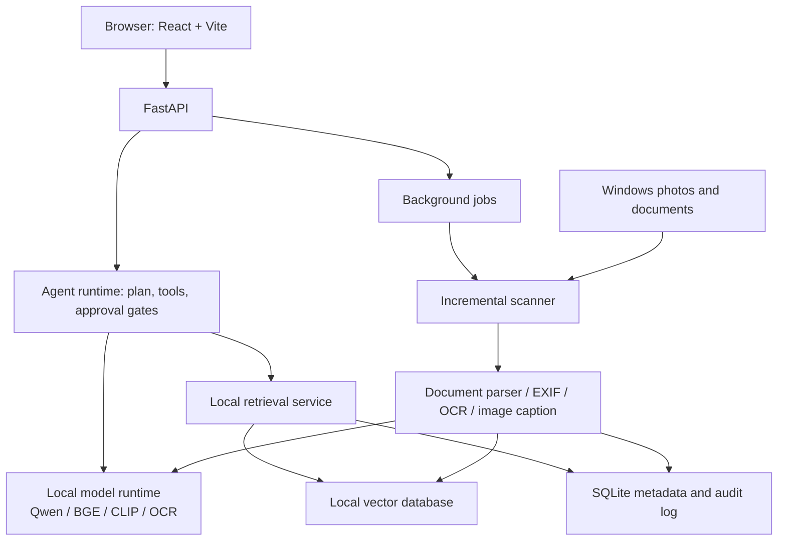
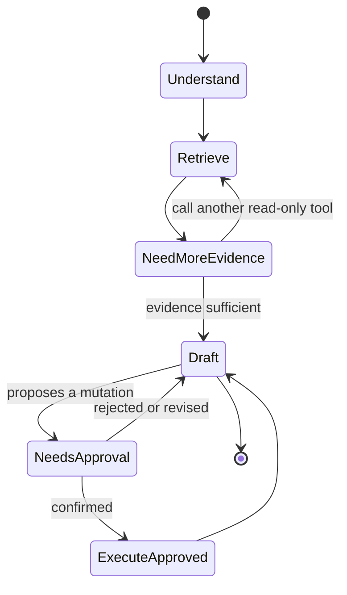
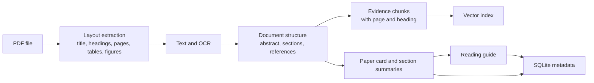
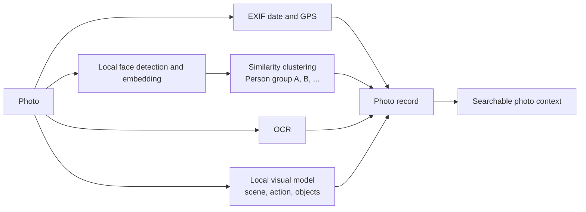
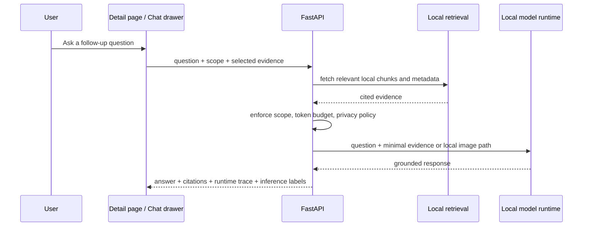
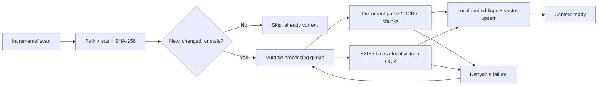

# Personal Knowledge Lab - Historical Design Guide

> Archived design history, sanitized for publication. This document mixes implemented
> features with proposals. Use README.md and docs/configuration.md for Lentica's
> current installation and runtime behavior; old workstation commands are not a runbook.

> 给 WSL Codex 的执行指令：请阅读并遵循本文档，在当前目录实现 Personal Knowledge Lab。先完成 Phase 0 和 Phase 1 的可运行 MVP，再继续后续阶段。每完成一个 Phase，运行测试和开发服务，报告实现结果、访问 URL、未解决事项。本项目当前采用完全本地模型模式，不调用外部 LLM API，不读取、复制、输出或依赖任何 API Key。不要对用户文件执行未确认的移动、重命名或删除。

## 1. Mission

Build a local-first personal knowledge application for Windows files:

- Photos: `C:\\Users\\Example Person\\Downloads\\iCloud 照片\\iCloud 照片`
- Documents: `C:\\Users\\Example Person\\Documents\\Documents\\Documents`

The application must let the user query photos and documents in natural Chinese, trace every answer back to a local file, and continuously update its local index. It is also a learning project for RAG, tool calling, agent workflows, background jobs, and a full-stack web app.

Do not train a foundation model in the first version. Use retrieval-augmented generation (RAG): store the corpus locally, retrieve relevant evidence locally, and run all planning, generation, embeddings, OCR, and image understanding through local models or deterministic local code. External LLM APIs are out of scope for the current implementation.

## 2. Non-negotiable boundaries

- Run the project in WSL2 at `~/work/personal-knowledge-lab`.
- Keep source files on Windows and access them read-only through:
  - `/path/to/photos`
  - `/path/to/documents`
- Keep SQLite, vector indexes, caches, logs, and virtual environments in the WSL filesystem, never under `/mnt/c`.
- Never store API keys in source code or Git. The current implementation must not read `LLM_BASE_URL`, `LLM_API_KEY`, or provider credentials for runtime behavior. If legacy settings exist in `~/.env`, show only that external API mode is disabled and do not call it.
- Do not automatically move, rename, or delete a personal file. Agents may propose actions; the UI must require explicit confirmation before a destructive or externally visible action.
- Every answer grounded in the knowledge base must show source file paths and page/segment references.
- The configured default sources are automatically ingested in the background. Text, document, OCR, and visual-model analysis must remain local. Source documents and photos must not be uploaded to a remote model provider.

## 3. Local model runtime

The project runs in local-only mode. Model discovery is a local registry plus capability probes against files and processes on this machine, not `GET /v1/models`.

Known local model assets and roles:

- `Qwen/Qwen2.5-VL-3B-Instruct`: local vision-language model for photo captioning, OCR-like visual text reading where reliable, scene/object/action descriptions, and optional grounded photo discussion.
- `openai/clip-vit-base-patch32`: local text-image retrieval model already validated for photo semantic search. It is acceptable as the first image retrieval baseline.
- `BAAI/bge-m3`: preferred local multilingual embedding model for document chunks, Chinese queries, and mixed Chinese/English notes.
- Optional local text model such as `Qwen2.5-3B-Instruct` or another small Qwen instruct model: grounded answer synthesis only after retrieval. If no local text model is enabled, answer with an extractive evidence summary.

Implement a model registry with explicit capability flags and local paths:

- `chat`: can synthesize a grounded answer from retrieved evidence.
- `embedding_text`: can embed document chunks and user queries.
- `embedding_image`: can embed photos or align text with images.
- `vision_caption`: can caption an image.
- `vision_ocr`: can extract visible text from an image, marked as best-effort unless a dedicated OCR engine is used.
- `rerank`: can rerank retrieved candidates.

Model profiles must include runtime type (`local_transformers`, `local_onnx`, `deterministic`, `external_disabled`), model path or ID, device, dtype, version/prompt version, memory budget, and enabled state. The Models page must clearly show that external API mode is disabled.

Current validated local model path for photo captioning:

```text
/path/to/models/qwen-vl
```

The project may reuse that local model path initially, but the durable design should keep model caches under the WSL filesystem and register them by configuration rather than hard-coding a path into business logic.

## 4. Architecture



Use a modular monolith, not microservices. One FastAPI process plus one or more local workers is enough for the first version. Long-running model workloads should live in workers so the web API stays responsive.

Recommended stack:

- Frontend: React, Vite, TypeScript, TanStack Query, React Router, Tailwind or a compact component library.
- API: FastAPI, Pydantic, SQLAlchemy, Uvicorn.
- Jobs: start with a SQLite-backed job table and a Python worker process. Do not introduce Redis/Celery until needed.
- Documents: PyMuPDF for PDF, python-docx for DOCX, openpyxl for XLSX, python-pptx for PPTX.
- Images: Pillow + EXIF extraction; OCR as a local adapter; visual captions through a local Qwen2.5-VL adapter.
- Retrieval: Chroma for the first iteration; hide it behind a repository interface so Qdrant can replace it later.
- Embeddings: local BGE-M3 initially; the embedding implementation must be swappable.

Runtime ports and process boundaries:

- FastAPI app: default `127.0.0.1:8000`, owns browser/API contract, retrieval, jobs, and metadata.
- Frontend dev server: default `127.0.0.1:5173`.
- Local model workers: no public network port by default. They communicate through the SQLite queue or localhost-only internal endpoints if needed.
- External machines must not access models unless the user explicitly starts a service with `--host 0.0.0.0` and understands the privacy impact.

Local model loading policy:

- Do not reload large models for every request when a queue worker can keep them warm.
- Qwen2.5-VL is used for batch photo captioning and optional photo discussion, not for every search request.
- The preferred Qwen2.5-VL runtime is the external localhost service managed under `/path/to/model-service`. The in-process transformers adapter remains a fallback/debugging path.
- CLIP/BGE embedding models may stay warm inside the API or a lightweight retrieval worker.
- If GPU memory is constrained, prefer one active large model at a time and queue lower-priority work.

## 5. Repository layout

```text
personal-knowledge-lab/
  DESIGN_GUIDE.md
  README.md
  .gitignore
  backend/
    app/
      api/
      agents/
      core/
      db/
      ingestion/
      llm/
      retrieval/
      workers/
    tests/
  frontend/
    src/
      pages/
      components/
      api/
  data/                 # gitignored; lives in WSL
    chroma/
    cache/
    logs/
```

## 6. Data model

SQLite is the source of truth for metadata and job state. The vector database stores searchable chunk vectors only.

Minimum tables:

- `sources`: configured source roots, enabled flag, scan settings.
- `files`: canonical path, type, byte size, modified time, SHA-256, ingestion status, error.
- `documents`: parser metadata such as page count and title.
- `chunks`: source file ID, text, page/segment number, chunk hash, vector record ID.
- `images`: EXIF time/location, caption, OCR text, tags, visual-analysis status.
- `images.context_json`: structured visual context collected from local Qwen-VL or a deterministic fallback. The current photo context contract is versioned by `images.context_version`; changing the prompt, OCR strategy, or vector namespace layout must bump this version so old photos are rebuilt instead of silently skipped.
- `ingestion_jobs`: queued/running/succeeded/failed, counters, error details.
- `agent_runs`: user goal, plan, tool calls, result, runtime/token/resource telemetry.
- `model_profiles`: model ID, role, capabilities, enabled state.
- `processing_tasks`: idempotency key, file ID, content hash, pipeline stage, priority, state, attempt count, next attempt, worker ID, rate-limit delay, and error details.
- `processing_runs`: immutable attempt-level history including started/finished time, model profile, token usage, output artifact IDs, and error details.

Use `SHA-256` plus modification time to make indexing incremental. On each scan:

1. New file: parse and index.
2. Existing file with unchanged hash: skip.
3. Existing file with changed hash: remove old chunks, then re-index.
4. Missing file: mark as missing and remove its vectors, but retain audit history.

Never enqueue work directly from a directory scan without an idempotency check. A task key must include the file content hash, pipeline stage, and relevant model/processor version. This permits retries while preventing duplicate captions, OCR, summaries, or vectors for the same input.

### Photo context extraction contract

Qwen-VL is a local context collector, not the search engine. It should run in background workers, keep the model warm when possible, and output a stable JSON object for every indexed photo:

```json
{
  "caption": "一句中文短描述",
  "dense_caption": "覆盖场景、主体、动作、物体、氛围、构图的高信息密度描述",
  "objects": [],
  "people": [],
  "scene": "",
  "activities": [],
  "text_in_image": "",
  "time_clues": [],
  "location_clues": [],
  "events": [],
  "colors": [],
  "style": "",
  "quality": "",
  "tags": []
}
```

The adapter must tolerate invalid model output: extract the JSON block when present, otherwise fall back to a dense caption and derived tags. Do not block indexing because a non-critical context field is missing.

For each indexed photo, write both metadata and multiple local vector namespaces:

- `image`: CLIP image feature from the original local image.
- `text`: aggregate of all searchable photo text.
- `caption`: short caption only.
- `dense_caption`: high-recall visual description.
- `ocr`: visible text from Qwen-VL or a future dedicated OCR adapter.
- `tags`: compact user-searchable tags.
- `objects`, `people`, `activities`: structured semantic fields.
- `metadata`: filename, EXIF date, GPS/location clues, event/time/style/quality clues.

Search must use local vectors and metadata only. The default ranking is hybrid:

1. Embed the user query locally.
2. Retrieve scores from all relevant vector namespaces.
3. Dynamically adjust weights for OCR-heavy, date/time, location, people, object, and scene queries.
4. Add lightweight metadata overlap for exact terms, years, locations, tags, OCR text, and filenames.
5. Return `confidence`, per-namespace scores, matched terms, and a human-readable match reason.

This makes the UI explain why a photo matched without asking Qwen during search. Qwen may be used later for explicit selected-photo visual grounding only, and that must be traced and cached.

## 7. Retrieval and answer contract

For every user question:

1. Classify the request: chat, document search, photo search, report, or maintenance task.
2. Rewrite the query with deterministic rules first. Use a local text model only when it is enabled and already loaded or cheap to load.
3. Retrieve local chunks using semantic search plus metadata filters.
4. Optionally rerank the top candidates.
5. Give only high-confidence evidence to the local answerer.
6. Return an answer, confidence/uncertainty, and a structured sources list.

The UI must render each source as a clickable local path. For documents, show page numbers. For images, show a thumbnail and the original Windows path.

Never tell the local model that unsupported facts are present in the sources. The answer prompt must say: when evidence is insufficient, say so and name the closest available sources. If no local chat model is enabled, use an extractive answerer that quotes or summarizes the top retrieved snippets without inventing connective claims.

Answer modes:

- `extractive_local`: default and safest. It returns a concise Chinese answer assembled from retrieved chunks and image captions, with citations. No generative model required.
- `local_grounded_generation`: optional. A local text model synthesizes an answer from retrieved evidence only. The response must cite every important claim.
- `local_visual_grounding`: optional for a single photo or small selected set. Qwen2.5-VL may inspect the original local image when existing caption/OCR is insufficient. This must be explicit in the trace and cached by image hash, prompt version, and model profile.

## 8. Agent tools and approval gates

Expose narrow tools rather than one unrestricted file-system tool:

- `search_knowledge(query, filters)`
- `get_source_excerpt(file_id, page_or_segment)`
- `get_image_metadata(file_id)`
- `request_image_analysis(file_id, question)`: enqueue or run local Qwen2.5-VL analysis only.
- `start_incremental_ingestion(source_id)`
- `create_report(scope, template)`
- `propose_file_actions(rule)`

`propose_file_actions` must never mutate files. Any future mutation requires an explicit approval record in the UI and a separate execution endpoint.

The agent runtime should be a small explicit state machine:



## 9. Web information architecture and wireframes

Navigation:

- Chat: natural-language Q&A with sources and retrieval trace.
- Library: source roots, indexed files, metadata, and re-index controls.
- Jobs: ingestion progress and errors.
- Agents: durable scheduled/manual tasks and run history.
- Models: local model registry, role assignment, capability probes, device/memory state.
- Settings: source paths, privacy mode, local-only mode, never raw secrets.

### Chat

```text
+--------------------------------------------------------------------------------+
| Personal Knowledge Lab  [Search or ask a question................] [Model Auto]|
+----------+---------------------------------------------------------------------+
| Chat     | Ask about your photos and documents                                 |
| Library  | [What did I plan to finish for GPU learning?................] [Send]|
| Jobs     |                                                                     |
| Agents   | Answer: ...                                                         |
| Models   |                                                                     |
| Settings | Sources                                                             |
|          | [PDF] plan.pdf p.3                         [Open]                  |
|          | [MD]  todo.md                               [Open]                  |
|          | Retrieval trace: rewrite -> retrieve -> rerank -> answer           |
+----------+---------------------------------------------------------------------+
```

### Library

```text
+--------------------------------------------------------------------------------+
| Library                                                    [Run incremental scan]|
+--------------------------------------------------------------------------------+
| Source root                                      Type     Files  Last scan  State|
| iCloud photos                                    Image    ...    ...        Ready|
| Documents                                        Mixed    ...    ...        Ready|
+--------------------------------------------------------------------------------+
| Filters: [Type] [Date] [Tag] [Status]      Selected: [Re-index] [View details]|
| Path                                  Summary / tags              Index status |
| .../IMG_1234.jpg                     beach, sunset, friends       Indexed      |
+--------------------------------------------------------------------------------+
```

### Agents

```text
+--------------------------------------------------------------------------------+
| Agents                                                        [New agent task] |
+--------------------------------------------------------------------------------+
| Task                       Schedule       Latest run     State       Action   |
| Incremental ingestion      Daily 01:00    26 new files   Succeeded   View     |
| Weekly learning report     Sun 20:00      Waiting        Paused      Run now  |
| Photo organization ideas   Manual         Not run         Draft       Edit     |
+--------------------------------------------------------------------------------+
| Agent run detail: goal | plan | tool calls | sources | runtime | approval history |
+--------------------------------------------------------------------------------+
```

## 10. Delivery phases

### Phase 0: foundation

- Initialize repository, `.gitignore`, backend and frontend. Do not create a project `.env` containing secrets. Legacy `~/.env` model settings may be detected only to show that external API mode is disabled.
- Add health endpoint and a settings screen that verifies source paths, data paths, and local-only mode.
- Implement `GET /api/models` from the local model registry and capability probes. Do not call `GET /v1/models`.

### Phase 1: document RAG MVP

- Configure the Documents source root.
- Parse TXT, Markdown, PDF, and DOCX.
- Build local embeddings with BGE-M3 or a deterministic fallback, and store vectors through the retrieval repository. Chroma is preferred when installed; SQLite/TF-IDF may remain as a fallback for early development.
- Deliver Chat with citations, extractive local answers, and the Library source/file view.

Acceptance: a question about an indexed document returns an answer with the exact Windows path and page/segment.

### Phase 2: incremental ingestion and jobs

- SQLite job state, worker process, progress API, Jobs page.
- Hash-based incremental scan and error retry.

Acceptance: adding/changing one source document updates only its own chunks.

### Phase 3: photo knowledge

- EXIF extraction and basic filename/date search.
- Capability probe for a local vision model.
- Caption/OCR job only when a compatible local image-understanding model or local OCR engine is configured.
- Support small batch runs such as `max_files=10` or `max_indexed=10` so the user can inspect results before continuing.

Acceptance: the user can search photos by date, local metadata, and completed local captions; semantic visual search is clearly marked partial until visual analysis completes.

### Phase 3A: validated local photo RAG bridge

A prototype already exists under:

```text
/path/to/photo-rag-reference
```

Validated behavior from that prototype should guide the production implementation:

- Qwen2.5-VL-3B can run locally on the RTX 5070 Ti and generate Chinese captions for iCloud photos.
- CLIP can provide text-to-image retrieval over locally stored vectors.
- Full photo analysis should not run as one unbounded operation. Use small batches and show progress.
- The user should be able to inspect results after each batch before continuing.
- Logs must be written to the WSL filesystem, for example `data/logs/index.log`.
- A web query service may stay up while batch captioning is paused or resumed.

Production work should migrate useful code patterns, not import the prototype as an opaque dependency. The target shape is:

```text
backend/app/ingestion/images.py       # EXIF, thumbnails, image records
backend/app/models/photo_context_prompt.py # shared photo context schema and prompt
backend/app/models/vision_service.py  # vLLM client plus local fallback adapters
backend/app/models/local_vision.py    # in-process Qwen2.5-VL fallback adapter
backend/app/models/local_clip.py      # CLIP adapter or image embedding implementation
backend/app/workers/image_worker.py   # durable batch processing
backend/app/retrieval/photo_search.py # photo retrieval and source formatting
```

### Phase 4: controlled agents

- Implement tool registry, run persistence, agent trace UI, and approval gates.
- Create two starter tasks: daily incremental ingestion and weekly learning report.

Acceptance: every agent run is inspectable and performs no file mutation without confirmation.

## 11. Implementation rules for Codex

- Before each phase, inspect the existing files and preserve user changes.
- Prefer simple, typed interfaces and tests around parsers, hashing, retrieval, and approval logic.
- Do not add LangChain/LlamaIndex in Phase 0 or 1. First implement the RAG pipeline directly so its behavior is understandable.
- Do not add Docker, Redis, authentication, or multi-user support unless a concrete requirement appears.
- Do not use a cloud-hosted vector database for the initial implementation.
- Provide a clear local development command and run the dev server after each usable frontend milestone.

## 12. PDF and paper intelligence

PDF ingestion is not merely text extraction. Build a layered, traceable representation so the user can ask both broad and precise questions.



### 12.1 PDF context layers

For every PDF, preserve these layers:

- File layer: canonical Windows path, hash, modified time, file type, page count.
- Layout layer: page number, heading hierarchy, tables, figures, captions, and whether OCR was required.
- Evidence layer: semantically coherent chunks with exact page number, heading path, and character offsets.
- Summary layer: one-sentence, short, and detailed summaries; section summaries must cite the evidence chunks used.
- Learning layer: prerequisites, reading order, key pages, open questions, limitations, and suggested exercises.

For research papers, detect or infer common structure: title, authors, abstract, introduction, related work, method, experiments, results, conclusion, limitations, and references. The detector must tolerate papers that use different headings.

### 12.2 Paper outputs

The UI should offer three generated views, all cached by file hash and model profile:

- Paper card: title, year, domain, research question, claimed contribution, method, evidence, results, limitations, and keywords.
- Layered summary: one sentence, approximately 300 Chinese characters, then section-by-section summary.
- Reading guide: estimated time, prerequisite concepts, recommended section order, most valuable pages, questions to keep in mind, and practical follow-up work that relates to the user's existing knowledge base.

The reading guide is personalized only from relevant local notes that retrieval can cite. It must not invent the user's skill level or claim a relationship without evidence.

### 12.3 PDF interaction design

```text
+--------------------------------------------------------------------------------+
| < Back to Library      Attention Is All You Need                         [Open] |
+----------------------+---------------------------------------------------------+
| Overview | Summary | Reading Guide | Pages | Related Notes                     |
+----------------------+---------------------------------------------------------+
| Research question: Can attention replace recurrence for sequence modeling?    |
| Contribution: ...                                             Confidence: High |
|                                                                         [Regenerate]
| Key results                                                               |
| - ... [p. 5]                                                              |
| - ... [p. 7]                                                              |
+---------------------------+---------------------------------------------------+
| Reading guide             | PDF viewer                                        |
| 1. Read Abstract (p. 1)   |                  [rendered page]                 |
| 2. Read Method (p. 3-5)   |                                                   |
| 3. Compare to your note   |                                                   |
| Prerequisites: ...        |                                                   |
+---------------------------+---------------------------------------------------+
```

Clicking a cited page or evidence item must open that exact page in the local PDF viewer. Generation controls should show the model, source scope, generation time, and cache status.

## 13. Classification and photo intelligence

### 13.1 Document taxonomy

Document classification has three independent layers:

- Deterministic attributes: extension, source root, directory, filename, timestamps.
- Model-assisted semantic labels: paper, course note, project document, invoice, contract, meeting note, code reference, and so on.
- User taxonomy: editable hierarchical labels such as `AI / GPU / Rust / Learning plan / Work`.

Store automatic labels with confidence and provenance. User labels override model labels but do not erase them. The Library page must support filtering by any layer and bulk confirmation of suggested labels.

### 13.2 Photo representation

Each photo can contain:

- Basic metadata: canonical path, hash, EXIF date/time, GPS coordinates, device, album directory.
- Visual description: scene caption, objects, actions, possible relationships, and confidence.
- OCR: extracted text and bounding boxes where supported.
- Location candidates: EXIF GPS first, then user album/folder clues, OCR addresses or landmarks, then uncertain visual inference.
- Face observations: one record per detected face, bounding box, quality score, and local face embedding.
- Person cluster: a local grouping of similar face embeddings, with user-controlled display name and merge/split actions.

Do not use external identity lookup or claim a real-world identity from a face. A cluster must be named only by the user. Before naming, call it `Person group A`, `Person group B`, and so on. Face embeddings, cluster membership, and names must remain local. When a local visual model profile is configured and enabled, the background worker may analyze source photos locally to generate captions, OCR-like visible text, scene, action, and location-candidate context. Photos must not be uploaded to a remote service.

### 13.3 Photo analysis pipeline



Location confidence order is: EXIF GPS > explicit user label > folder/album clue > OCR landmark/address > visual inference. Action labels must use calibrated language such as "likely hiking" when confidence is not high.

### 13.4 Photo interaction design

```text
+--------------------------------------------------------------------------------+
| Photos                         [Search photos...............................] |
+----------------+---------------------------------------------------------------+
| Filters        |  October 2025, coastal trip                                  |
| Date range     |  [photo] [photo] [photo] [photo]                              |
| Place          |  Sunset at the beach  People: Person group A, Person group C |
| People         |  Actions: walking, group photo             [Open] [Edit tags] |
| Actions        |                                                               |
| Confidence     |  [photo] [photo] [photo] [photo]                              |
+----------------+---------------------------------------------------------------+
| Person groups  | Detail drawer                                                 |
| A (124 photos) | Date: 2025-10-03  Location: EXIF GPS / high confidence       |
| B (77 photos)  | Caption: Three people walking by the sea at sunset.           |
| [Review groups]| OCR: ...       [Confirm tags] [Correct] [Analyze deeply]     |
+--------------------------------------------------------------------------------+
```

The `Review groups` workflow must make face-cluster errors easy to correct: select photos, split a cluster, merge clusters, hide a face, or assign/remove a user display name. Corrections become local training signals for future clustering thresholds, not a request to identify people online.

Initial implementation:

- Tables: `face_detections` stores `file_id`, `cluster_id`, bbox, detector score, and local embedding JSON. `person_clusters` stores a stable `person_NNN` label, optional user `display_name`, centroid embedding, face count, cover file, ignored flag, and confidence.
- Runtime: `InsightFaceDetector` uses `insightface.FaceAnalysis(buffalo_l)` when `insightface` is available in the worker Python environment. If the runtime is unavailable, the worker records `face_unavailable` instead of inventing weak clusters.
- Execution provider: prefer `CUDAExecutionProvider` when ONNX Runtime exposes it; otherwise use `CPUExecutionProvider`. CPU mode is valid and produces real face embeddings, just slower. On the current WSL setup, ONNX Runtime reports CPU provider only, so the validated path is CPU face detection plus GPU vLLM photo context.
- Clustering: each new embedding is normalized and assigned to the closest centroid when cosine similarity is at least `0.58`; otherwise a new `person_NNN` cluster is created. This is deliberately conservative and user-correctable.
- Backfill: `index_faces` worker tasks can scan already-indexed photos and populate people without rebuilding Qwen/VL context or CLIP/BGE vectors.
- Search: a named cluster boosts matching photos when the query contains the user display name or the cluster label.

## 14. Expanded web UI specification

The application should feel like a calm personal workbench, not a marketing page. Use a left navigation rail, a compact top bar, information-dense tables and galleries, and a right-side details drawer. Avoid nested cards and oversized headings.

### 14.1 Primary application shell

```text
+--------------------------------------------------------------------------------+
| Personal Knowledge Lab   [Search all knowledge........................] [Auto] |
+----------+---------------------------------------------------------------------+
| Chat     | Route title                                      [Run scan] [New task]|
| Library  +---------------------------------------------------------------------+
| Papers   | Main working surface                                                |
| Photos   |                                                                     |
| Jobs     |                                                                     |
| Agents   |                                                   Details drawer      |
| Models   |                                                   source / metadata   |
| Settings |                                                                     |
+----------+---------------------------------------------------------------------+
```

Pages and their primary jobs:

- Chat: grounded questions across all sources, answer with citation cards and retrieval trace.
- Library: source roots, files, taxonomies, indexing state, and bulk classification review.
- Papers: paper cards, summaries, reading guides, PDF viewer, and note connections.
- Photos: timeline/grid/map/person-group views, semantic filters, and correction workflow.
- Jobs: ingestion and analysis queues, progress, retry, logs, and errors.
- Agents: recurring/manual tasks, plans, tool traces, output artifacts, and approval history.
- Models: local model catalog, role assignment, capability tests, GPU/CPU memory state, and processor versions.
- Settings: local source roots, privacy mode, and configuration health only; never render secrets.

### 14.2 Key states

Every async surface needs explicit states: not indexed, queued, parsing, waiting for model, indexed, partial success, failed, and stale. A failure should show the file path, failed stage, concise error, retry action, and a link to diagnostic details.

For model-generated content, distinguish:

- `Grounded`: all important claims cite local evidence.
- `Inferred`: derived from image/model analysis, with confidence.
- `User confirmed`: metadata, taxonomy, or person name explicitly corrected by the user.

### 14.3 First UI delivery order

1. Application shell, Settings health state, and Models page.
2. Library table with source roots and ingestion jobs.
3. Chat with citation cards and source detail drawer.
4. Papers page and PDF reader with reading guide.
5. Photos grid, metadata filters, then person-group review only after local face clustering is ready.

## 15. Deep-dive Local Model Conversations

Add an on-demand "Discuss" mode for a specific document, paper, photo, person group, or saved search. Its purpose is a multi-turn, evidence-grounded conversation when the user needs details beyond a cached summary.

This is a local computation path: each turn may retrieve fresh local evidence and call a local model process if one is enabled. It is separate from background ingestion and should visibly show whether a local model is being used or whether the answer is extractive-only. Background ingestion automatically constructs baseline context for all configured default sources; deep-dive requests add question-specific context on top.

### 15.1 Conversation modes

| Scope | Example user question | Evidence passed to the model |
| --- | --- | --- |
| Single document | "Explain the experiment setup on page 6." | Selected page, surrounding chunks, tables/figure captions, page reference |
| Paper | "Why does the author claim this improves efficiency?" | Relevant method/results chunks, paper card, user-selected pages |
| Photo | "What details in this photo support that it was taken at the beach?" | Local metadata, OCR, existing caption; source image only if a verified local vision model is enabled |
| Person group | "Show when this group appears with Person group B." | Local cluster membership, dates, locations, selected thumbnails; never an identity lookup |
| Search result | "Compare these three documents' approaches." | Top cited chunks from the selected result set |

### 15.2 Request pipeline



The API sends only the minimum required evidence to the local model runtime. For a PDF, prefer extracted text and render page images locally only when layout, figures, or formulas matter. For photos under configured default sources, automatic ingestion uses the original local image path with the enabled local visual-model profile to construct baseline context. During deep-dive discussion, the same original image may be supplied again to the local model when the question requires new visual reasoning. The system must record every model analysis request in the processing and conversation trace, including model path/profile, device, prompt version, duration, and whether the original image was inspected.

### 15.3 Deep-dive UI

The document and photo detail pages include a `Discuss` action. It opens a persistent right drawer on wide screens and a dedicated full-screen page on small screens.

```text
+--------------------------------------------------------------------------------+
| Paper: Example Paper                                      [Open PDF] [Discuss] |
+----------------------------------------+---------------------------------------+
| PDF / metadata / summary               | Discuss this paper                    |
|                                        | Scope: [This paper v] [p. 4-7]        |
| [rendered page with evidence highlights]| Model: local-qwen  [Local]            |
|                                        +---------------------------------------+
|                                        | You: Why is this ablation important?  |
|                                        |                                       |
|                                        | Assistant: ... [p. 5] [p. 7]          |
|                                        |                                       |
|                                        | Evidence used (3)  Runtime / tokens     |
|                                        +---------------------------------------+
|                                        | Ask a detailed question...      [Send] |
+----------------------------------------+---------------------------------------+
```

For a photo, the same drawer shows the source image and an explicit context selector:

```text
+----------------------------------------------------------------------------+
| IMG_1234.jpg                                              [Discuss photo]  |
+---------------------------+------------------------------------------------+
| [photo preview]           | Context used                                  |
|                            | [x] EXIF date and GPS                         |
|                            | [x] Existing caption and OCR                  |
|                            | [x] Original photo (local analysis)           |
|                            |                                                |
|                            | Ask: What activity is happening here?         |
|                            | [Analyze locally]                             |
+---------------------------+------------------------------------------------+
```

### 15.4 Conversation behavior and safety

- Keep conversation history locally in SQLite. Store role, message content, cited evidence IDs, selected scope, model profile, token usage, and request timestamp.
- Do not silently use the entire conversation history. Build each turn from a compact recent history plus the current retrieved evidence, within a configurable token budget.
- Answers must attach citations to claims about local files. Inferences from a visual model must be visually marked `Inferred` with confidence.
- The user can expand or reduce scope: current page, current file, selected pages/photos, related notes, or all indexed knowledge.
- Support `Show evidence`, `Open source`, `Regenerate`, `Ask with a different model`, and `Clear conversation` actions.
- Show the active model and a visible `Local` or `Extractive` indicator for every response. The initial source setup screen discloses that automatic ingestion remains on this machine and does not upload document content or source images to a remote service.
- Never expose internal prompts or raw model runtime arguments in the browser.

### 15.5 Backend contract

Implement a durable conversation entity and narrow API endpoints:

- `POST /api/conversations`: create a conversation with a typed scope.
- `POST /api/conversations/{id}/messages`: submit a question; stream the answer and structured citations.
- `GET /api/conversations/{id}`: retrieve locally stored messages and trace metadata.
- `POST /api/conversations/{id}/scope`: change scope and selected files/pages.
- `POST /api/conversations/{id}/clear`: clear local history after explicit confirmation.

Use server-sent events or WebSocket streaming for the answer. The backend owns evidence selection and local model calls; the frontend must never call a model process directly.

### 15.6 Delivery order update

Build the deep-dive experience after the basic cited Chat view and before autonomous agents:

1. Reusable conversation drawer with a single-document text scope.
2. Streaming response, citation cards, evidence inspector, and local message persistence.
3. PDF page/section scope selector and paper-reading-guide follow-up prompts.
4. Photo metadata discussion and automatic original-image analysis through the configured local visual-model profile; record unsupported-model errors as retryable tasks rather than blocking the pipeline.
5. Cross-document comparison and saved-search conversation scopes.

## 16. Automatic context pipeline, progress, and rate limiting

The application must automatically construct and maintain context for both default source roots. The scanner and workers run independently of the browser, so closing the page does not stop ingestion.

### 16.1 Pipeline stages



Document task sequence:

1. Detect type and extract text/layout.
2. Render/OCR pages only where extraction is insufficient.
3. Build chunks with page and heading provenance.
4. Generate classification, summary, and paper reading guide where applicable.
5. Compute local embeddings and upsert vectors.

Photo task sequence:

1. Read EXIF and compute content hash.
2. Run local face detection/embedding and update person clusters.
3. Analyze the original image through the configured vision backend for caption, OCR-like visible text, scene, action, and location candidates. The preferred backend is `vllm` at `http://127.0.0.1:8100`; `transformers` and `basic` remain fallback modes.
4. Normalize the result into structured metadata and searchable text.
5. Compute local embeddings and upsert vectors.

### 16.1.1 vLLM vision service integration

`personal-knowledge-lab` must not own the long-lived Qwen-VL model process. The app integrates with the shared service in `/path/to/model-service`:

```text
ImageWorker
  -> VisionServiceClient
    -> VllmQwenClient
      -> http://127.0.0.1:8100/v1/chat/completions
```

The worker still owns scanning, EXIF, thumbnails, SQLite writes, CLIP/BGE embeddings, and vector search. The vLLM service only returns model output for the `photo_context` schema.

When `vision_backend=vllm`, Qwen-VL is assumed to be a long-lived GPU service. Photo workers should default `embedding_device=cpu` for CLIP/BGE so context extraction is not blocked by loading a second model stack into the same 16 GB GPU. If a larger GPU is available, the frontend or queue payload can override `embedding_device=cuda`.

Queue settings must include:

- `vision_backend`: `vllm`, `transformers`, or `basic`.
- `vision_endpoint`: default `http://127.0.0.1:8100`.
- `vision_model`: default `qwen-vl-photo-context`.
- `vision_timeout_seconds`: default `180`.
- `vision_fallback`: default `transformers`.

If the vLLM service is unavailable, the worker should fall back to transformers when configured, or fail the task with a retryable service error. Jobs must show `/api/vision/status` so the user can verify whether Qwen-VL service is reachable before resuming the queue.

### 16.2 Idempotency and incremental rules

- A file is current only when its SHA-256 and all required processor/model versions match the most recent successful run.
- Changing the caption model, prompt version, OCR engine, chunking strategy, or embedding model marks only the relevant downstream stages stale.
- Retries reuse the same idempotency key and must not create duplicate chunks, face observations, captions, or vector records.
- New files receive high priority; changed files receive normal priority; bulk re-indexing receives low priority.
- Deletions remove active vectors and mark file metadata missing; never delete the original Windows source file.

### 16.3 Queue and rate-limit policy

Use a durable SQLite queue initially. A worker claims tasks atomically and records a lease/heartbeat so interrupted jobs can be recovered.

Apply independent limits per pipeline category:

| Category | Concurrency | Limit | Behavior when exhausted |
| --- | ---: | --- | --- |
| Local parse/OCR | Configurable, CPU-bound | CPU worker count | Queue locally |
| Local embeddings | Configurable, GPU/CPU-bound | batch size and VRAM budget | Queue locally |
| Local vision model | Usually 1 GPU worker | VRAM budget, max pixels, max new tokens | Queue locally |
| Local text model | Usually 1 GPU/CPU worker | VRAM budget, context length | Queue locally or fall back to extractive answers |

Store limits in Settings and default conservatively. Implement leases, heartbeats, and retry delays per model profile. Permanent parse errors should become `Failed`; local model OOM, timeout, interrupted worker, and transient load failures should become `Waiting to retry` with a next-attempt timestamp. If repeated local model failures occur, keep metadata/lexical search available and mark semantic or visual stages as partial.

### 16.4 Progress and operational UI

Add a persistent global processing indicator in the top bar:

```text
+--------------------------------------------------------------------------------+
| Personal Knowledge Lab                         Processing 1,248 / 18,420 [View]|
+--------------------------------------------------------------------------------+
```

The Jobs page must provide file-level and stage-level visibility:

```text
+--------------------------------------------------------------------------------+
| Processing jobs                 [Pause queue] [Resume] [Run incremental scan] |
+--------------------------------------------------------------------------------+
| Overall: 1,248 / 18,420   Ready: 1,009  Processing: 12  Waiting: 201  Failed: 26|
| Stage             Ready     Running   Waiting   Failed    Resource              |
| Photo vision      722       1         195       9         GPU worker, local     |
| Document parse    287       3         2         6         local                 |
| Embeddings        811       5         4         11        batch 32              |
+--------------------------------------------------------------------------------+
| File                                Stage          State             Action    |
| .../IMG_1234.jpg                    Vision context Waiting (00:42)   View     |
| .../paper.pdf                       PDF summary    Failed             Retry    |
+--------------------------------------------------------------------------------+
```

File detail views must show a compact processing timeline: discovered, hashed, parsed, analyzed, embedded, indexed, plus the processor/model version used. A `Reprocess` action should select stages explicitly instead of blindly repeating every stage.

### 16.5 Delivery priority

Implement this pipeline before bulk photo semantic features and before scheduled autonomous agents:

1. Source registry, scanner, file hashes, and durable job queue.
2. File-level status/progress UI and retry controls.
3. Document parse/chunk/embed pipeline.
4. Automated photo EXIF/face/local-vision/OCR pipeline with GPU/resource limiter.
5. Automatic PDF summary/reading-guide generation and taxonomy tasks.
6. Deep-dive chat using the completed baseline context.

## 17. TODO: Photo Search Quality

The current photo pipeline uses local Qwen-VL for context collection and local CLIP vectors for image/text alignment. To improve Chinese language-based photo search quality, implement these tasks next:

1. Add local BGE-M3 text/context embeddings.
   Use BGE-M3 for `caption`, `dense_caption`, `ocr`, `tags`, `objects`, `people`, `activities`, `location`, `event`, and `metadata` namespaces. Keep CLIP focused on image-vector retrieval.

2. Implement dual-path retrieval fusion.
   Run CLIP text-to-image retrieval and BGE text-to-context retrieval for each query, then fuse visual, semantic-text, metadata, and exact-match scores with explainable per-namespace contributions.

3. Extend the Qwen-VL photo context schema.
   Add `search_phrases`, `location`, `time`, `event`, `visual_attributes`, and `negative_clues`. These fields should be generated during background indexing and embedded into dedicated namespaces.

4. Add deterministic query expansion and query intent classification.
   Expand common Chinese photo-search terms before embedding, for example `聚餐 -> 餐厅 饭菜 合影 朋友 聚会 吃饭`. Classify query intent such as OCR/text, date/time, location, people, object, scene, event, and document-screenshot search, then adjust retrieval weights accordingly.

5. [done] Split photo date/location extraction into confidence tiers.
   The search index must distinguish confirmed metadata from inferred clues:
   `exif_time` is the strongest date source, followed by filename/path date patterns, filesystem modified time, then visual time clues. `gps_lat/gps_lon` is the strongest location source, followed by user labels, folder/album names, OCR landmarks/addresses, then Qwen-VL visual inference such as `beach`, `restaurant`, or `airport`. Store these as separate fields so UI and ranking can explain whether a result matched exact EXIF/GPS data or weaker context.
   Implemented as `photo_metadata_candidates` plus `metadata_candidates` / `metadata_text` inside image context. Sources currently include EXIF date/GPS, filename/path date patterns, path location segments, and Qwen-VL location/time clues.

6. [partial] Add GPS reverse-geocoding cache.
   When EXIF GPS is present, resolve it locally or through an explicitly configured geocoder into city, district, country, and optional POI candidates. Cache results in SQLite, write the human-readable value into `images.location`, and embed `location`, `location_clues`, and GPS-derived administrative names into dedicated retrieval namespaces. Never call a remote geocoder unless the runtime setting explicitly allows it.
   Implemented local cache table and deterministic `GPS lat, lon` display value. Remote or offline map reverse-geocoding remains intentionally unimplemented until a provider/runtime policy is configured.

7. [done] Parse date/location from file and album paths.
   Add deterministic parsers for patterns such as `IMG_20240701`, `2024-10 成都`, `杭州/西湖`, iCloud export directories, and camera roll names. Store parsed candidates with provenance (`filename`, `folder`, `album`) and confidence. Use these candidates for filtering and metadata scoring, but keep them below EXIF/GPS in ranking.
   Implemented in `backend/app/ingestion/photo_metadata.py`; candidates are persisted with provenance and consumed by metadata scoring and vector text.

8. [done] Make person labels first-class photo-search signals.
   User-assigned `person_clusters.display_name` values must be usable in Photos search. Query handling should first detect exact person-name or cluster-label mentions, then use those matches as a hard filter when the query is clearly person-scoped (`妈妈的照片`, `person_003`), or as a boost when the query combines person + scene/event (`妈妈在海边`, `张三生日`). The result explanation should show `person_cluster` as a match reason.
   Implemented exact display-name/cluster-label detection, result scoping for person queries, metadata boost, and `person_cluster` match reason.

9. [done] Add person aliases and relationship labels.
   A cluster needs optional aliases such as `妈妈`, `母亲`, `妈咪`, `Example Person`, or `person_003`. Query expansion should map aliases to canonical cluster IDs before vector search. This is important for Chinese semantic search because the embedding model may consider `妈妈` and `母亲` related, but the system should not rely only on vector similarity for identity-critical filtering.
   Implemented `person_aliases`, API schema, People page editing, and alias-aware exact matching.

10. [done] Embed named person context into dedicated namespaces.
   When a person cluster is named or renamed, regenerate lightweight photo text for affected files:
   `person: 妈妈 person_003`, `people: 妈妈 张三`, and co-occurrence phrases such as `妈妈 和 张三 合影`. Upsert these into `bge:people` or a dedicated `bge:person` namespace. This lets semantic queries such as `和妈妈一起吃饭` combine person constraints with scene/activity vectors instead of relying only on exact metadata overlap.
   Implemented people/context refresh plus `refresh_person_vectors` task that rewrites affected `text`, `people`, and `metadata` text vectors without rerunning Qwen-VL or image embedding.

11. [partial] Re-rank with person co-occurrence and confidence.
   For queries mentioning one person, boost photos containing that cluster. For queries mentioning multiple people, strongly boost photos where all clusters occur in the same file and moderately boost photos where only some occur. Weight by face detection score, cluster confidence, and whether the cluster has a user-confirmed display name. Ignore clusters marked `ignored`.
   Implemented ignored-cluster exclusion and all-person co-occurrence preference for multi-person queries. Detection-score and user-confirmed-name weighting are still TODO.

12. [done] Trigger lightweight reindex when People labels change.
   Updating `display_name`, aliases, ignored state, merge, or split should enqueue a small `refresh_person_vectors` task for only affected photos. It should not rerun Qwen-VL or CLIP image embedding. The task only updates context JSON person fields and BGE person/metadata vectors.
   Implemented for display name, aliases, and ignored state. Merge/split UI is not yet implemented.

13. [done] Keep People face analysis incrementally aligned with photo ingestion.
   Persist `images.face_analysis_status` and `images.face_indexed_at`. New or changed photos run InsightFace inside the photo pipeline; an automatic low-priority `index_faces` backfill consumes already-indexed photos whose status is `pending` or `failed` and which have no face detections. A no-face result is stored as `completed_no_face`, preventing repeated scans. The auto face task priority must be ahead of recurring photo work so it cannot starve behind photo queue tasks.

## 18. TODO: Multimodal Retrieval Quality Upgrade

### Current architecture audit

The current photo index is SQLite-backed, not Qdrant-backed. `photo_vectors` stores one normalized JSON vector per `(file_id, namespace)` and the photo search path currently loads matching rows and calculates cosine similarity in-process. Existing namespaces include `clip:image` for original-image visual retrieval and `bge:*` for Qwen-VL-derived text/context. Documents are a separate SQLite/TF-IDF pipeline; they do not yet have page images, OCR fallback, dense vectors, or layout regions.

The current search implementation must not compare or linearly blend raw CLIP and BGE cosine scores. They are different embedding spaces with unrelated score distributions. Current logical namespace aggregation can also collapse scores from different encoders. This is the highest-priority retrieval correctness issue.

Qwen-VL remains a background context collector only. It must not replace original image embeddings or run on every search request. Its current schema mixes visible facts with uncertain location/time/event interpretations, and OCR is currently best-effort VLM output rather than a dedicated OCR pipeline.

The current API builds CLIP/BGE embedders in the photo search request path. This must be replaced with a bounded warm retrieval runtime before enforcing query latency targets. With the 16GB GPU, vLLM Qwen-VL and CLIP/BGE must not be assumed to remain GPU-resident together; vLLM indexing uses CPU embeddings by default to preserve GPU memory.

### Ordered implementation plan

1. [partial] Establish an offline retrieval baseline before changing ranking.
   Add a versioned JSONL evaluation fixture covering visual, semantic, OCR, people, time, location, people-time-location, and document queries. Report Recall@1/5/10, MRR, nDCG@10, filter accuracy, P50/P95 latency, and index size. Every later phase must compare with this baseline. Implemented JSONL loading, Recall@1/5/10, MRR, nDCG@10, category aggregation, P50/P95 runner telemetry, unit tests, and an intentionally non-runnable example fixture. A real baseline requires user-confirmed `file_id` relevance labels; index-size and filter-accuracy reporting remain TODO.

2. [partial] Introduce a backward-compatible `AssetContext` v2 schema.
   Separate `observations` (directly visible facts), `inferences` (confidence-scored model interpretations), and `metadata` (EXIF, GPS, file facts, user-confirmed person/event data). The Qwen-VL prompt must require valid JSON, preserve visible text, avoid real-world identity inference, and never write model guesses into deterministic metadata. Invalid Qwen output must retain raw output for audit while allowing image vector, metadata, and OCR indexing to continue. Implemented the v2 Pydantic schema, Qwen-VL prompt, legacy projection, raw model-output retention for valid v2 responses, and deterministic metadata/person fields. Existing `photo_context` records remain readable and the worker context version was intentionally not bumped, so this does not silently re-run Qwen-VL across the existing library. Dedicated raw-output persistence for malformed model responses remains TODO.

3. [partial] Move context-to-text construction out of `image_worker.py`.
   Add `backend/app/embedding/context_text_builder.py`. Produce independent `caption`, `context`, and `ocr` texts; only include inference values above a configurable threshold in dense context. Keep OCR lexical terms separate from semantic context to avoid contaminating visual retrieval. Implemented `ContextVectorTexts` and deterministic high-confidence inference filtering. The worker retains a legacy namespace projection until independent retrievers replace legacy field vectors.

4. [partial] Replace cross-space score blending with independent retrieval and weighted RRF.
   Implement visual (CLIP text-to-image), caption/context (BGE), OCR dense, OCR lexical, and metadata/person retrievers independently. Each returns a ranking; weighted reciprocal-rank fusion combines ranks rather than raw cosine values. Person, explicit date, GPS/city, asset type, document ID, and page number must be SQL/payload filters where available. Implemented independent visual, caption, context, OCR-dense, and metadata rankings over the current SQLite storage plus weighted RRF. Person and year constraints retain the existing exact filter behavior. OCR lexical retrieval and location/asset-type SQL filters remain TODO.

5. [partial] Add deterministic `RetrievalPlan` query understanding.
   Parse person aliases, dates/ranges, known locations, asset type, OCR intent, and document intent with rules first. Route only relevant retrievers and expose the plan plus match evidence in debug responses. A local LLM planner is a fallback only, never required for ordinary queries. Implemented rule-based person alias, year/relative-year, location keyword, OCR/document intent, and lexical-term extraction. Person/year filters now use this plan; API debug exposure and full retriever routing remain TODO.

6. [todo] Add a dedicated local OCR and screenshot path.
   Classify photo versus screenshot/document page. Use a local OCR adapter with Qwen OCR as fallback, store normalized OCR text, and add lexical retrieval (SQLite FTS5/BM25 or equivalent) alongside OCR dense vectors. Exact code, errors, identifiers, and numbers must prefer lexical evidence.

7. [todo] Add the document page pipeline separately from photo ingestion.
   Preserve PyMuPDF native text, render page images, use OCR fallback, retain page/chunk provenance, and add page-level dense plus lexical retrieval. Do not treat ordinary photos and document pages as the same extraction workflow.

8. [partial] Add cached retrieval model lifecycle management.
   Keep CPU retrieval models warm behind a bounded registry or retrieval worker; do not instantiate CLIP/BGE for every API request. Coordinate GPU work with the external `pkl-vllm-service`: a backend-only lock cannot unload a model held by that separate service. Default to CPU embeddings while Qwen-VL vLLM is active, with queue-level serialization for optional GPU work. Implemented bounded in-process embedding cache and changed photo-search API/frontend defaults to CPU, preventing repeated model construction and avoiding default vLLM GPU contention. A dedicated retrieval worker and external vLLM lifecycle protocol remain TODO.

9. [todo] Add optional text cross-encoder reranking.
   Apply it only to RRF Top 50-100 candidates, preserve a feature flag and timeout fallback, and report reranking latency. It must be evaluated before enabling a VLM reranker.

10. [todo] Add optional VLM final reranking.
    Run only for Top 10-20 images/pages, serialize access to vLLM, require structured score/evidence output, and never let VLM output become a hard filter. Default disabled.

11. [todo] Evaluate SQLite versus Qdrant after RRF is verified.
    Do not introduce Qdrant merely for named-vector terminology. Migrate behind a repository interface only when corpus size or latency measurements show SQLite full scans cannot meet targets. Preserve old indexes until a versioned reindex, alias switch, and rollback path are validated.

### Phase 1 acceptance criteria

- One photo can store valid v2 context while old `photo_context` records remain searchable.
- Original CLIP image embedding still writes even when VLM context extraction fails.
- Observations, inferences, and deterministic metadata are independently inspectable.
- Caption/context/OCR vector text is deterministic and unit-tested.
- No raw CLIP/BGE score fusion changes are made until independent retrievers and RRF land together in the next phase.
