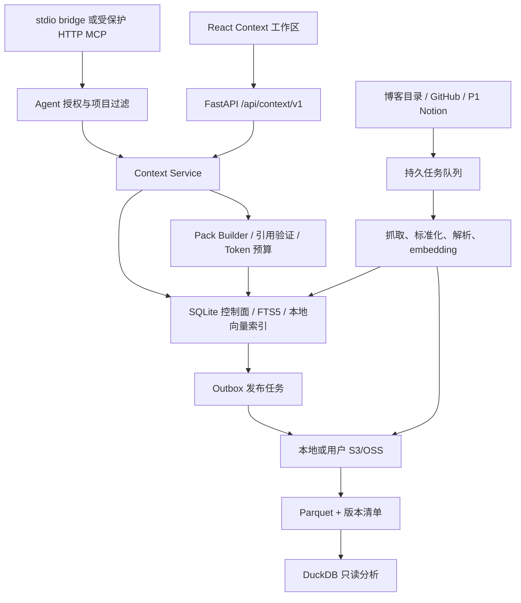
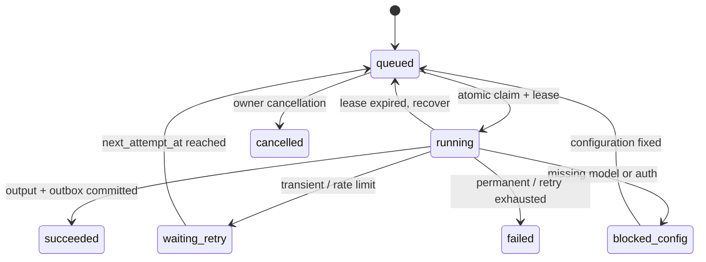

# 技术架构与演进决策

## 1. 现状和复用点（2026-10-25 只读检查）

项目已有 FastAPI/SQLAlchemy/SQLite；`backend/app/db/models.py` 包含 Source/File/Chunk、照片/人物、ProcessingTask/ProcessingRun；`api/routes.py` 是现有综合路由。前端 React 19、Vite、TanStack Query、lucide-react。现有检索包含 RRF/查询计划相关模块。

`core/config.py` 当前默认 local_only，仅检测遗留 env 存在，不读取凭证用于运行；这与早期文档中的 API 默认不同，以代码和本目录为本次起点。当前多个模块有未提交改动，只增量扩展。

| 现有模块 | MVP 使用方式 | 兼容约束 |
| --- | --- | --- |
| db/models.py + session.py | 保留旧表；新增独立 Context 表与迁移 | 不 drop/recreate data/knowledge.db |
| ingestion/scanner.py | 为博客/现有文档新增适配器 | 现有 Windows 源不全库重扫 |
| processing_tasks/runs | 扩通用任务、租约/尝试历史 | 历史 task payload 可读；新增 kind/version |
| retrieval/fusion.py | 复用 RRF，新增项目预过滤 | 不直接相加 CLIP/BGE 分数 |
| models/local_registry.py | 复用本地 capability 信息 | 缺模型走 extractive/degraded |
| frontend/src/pages | 新路由作为独立 Context 工作区 | 老 Chat/Photos/People 仍可访问 |

## 2. 组件和运行形态



进程：现有 API、独立 Context worker、可选客户端 stdio bridge。单机采用 SQLite WAL、短事务、原子 claim；DuckDB 单个分析进程，不把实时多写控制面塞给 DuckDB。

## 3. 存储决策

ADR-01：P0 使用 Parquet + manifest + DuckDB，不上 Iceberg。单机单写者能以较少组件实现可追溯和导出；Iceberg 的 catalog、提交和快照删除复杂性在首期缺乏收益。出现多写者、持续大规模更新或跨引擎需求后再迁移。

ADR-02：SQLite 为当前生效状态和授权的唯一控制面；对象/Parquet 是可重建的持久材料，不以“桶中找到就允许读取”为依据。新索引在完成后切 alias/version，不先删除旧版本制造空窗。

ADR-03：保留 StorageRepository 接口：put_if_absent、get、head、list_page、delete、publish_manifest、resolve_version。S3/OSS 分别验证条件写、版本、ETag、区域端点，不承诺 API 完全等价。

建议对象布局：

```text
context-plane/<owner-id>/
  raw/<source-id>/<item-id>/<revision>/content
  normalized/<snapshot-id>/documents.parquet
  normalized/<snapshot-id>/events.parquet
  normalized/<snapshot-id>/chunks.parquet
  normalized/<snapshot-id>/provenance.parquet
  manifests/<snapshot-id>.json
  packs/<project-id>/<pack-id>.json
  packs/<project-id>/<pack-id>.md
```

小样本使用每次导出一个 snapshot 的批量 Parquet，不每文档一个 Parquet。大规模按 owner/source/month 分区并做 compaction。URI 记录 provider/bucket/key/version，不持久化临时签名。

跨 SQLite 与对象存储不存在原子事务：DB 同一事务提交记录 + outbox；发布 worker 写不可变对象，验证校验和后以条件写发布 manifest；最后记录 published。失败恢复重用相同 object key/内容哈希。读取只使用已发布 manifest，不能读取半成品。

## 4. 逻辑 schema（新增 cx_ 前缀避免覆盖旧表）

所有新 ID 使用 UUID；UTC aware 时间；JSON 有 schema_version；SQLite 外键启用，按 scope/time/state 建索引。旧整型 file_id 只作为可空引用。

| 表 | 核心字段与约束 |
| --- | --- |
| cx_projects | id, title, goal, timezone, default_budget, revision, archived_at |
| cx_sources | id, connector_type, config_json（无密钥）, secret_ref, state, cursor_json, coverage_json, revision, last_success_at |
| cx_project_sources | project_id + source_id 唯一；允许 scope_json 子范围 |
| cx_items | source_id + external_id 唯一；kind, actor_kind, author_ref, source_uri, content_time, active_revision, deleted_at |
| cx_revisions | item_id + revision 唯一；content_sha256, storage_ref, normalized_sha256, parser_version, status |
| cx_events | id, source_item_revision_id, actor_kind, verb, object_ref, occurred_at, observed_at；源事件唯一键 |
| cx_chunks | revision_id + chunk_index + chunker_version 唯一；text, locator_json, text_hash, embedding_version |
| cx_claims | project_id, kind, text, origin, state, valid_from/to, supersedes_id, revision；候选/确认分开 |
| cx_claim_evidence | claim_id + revision/chunk_id + relation 唯一；supports/contradicts |
| cx_pack_builds | id, project_id, request_hash, state, progress, error, created_by |
| cx_packs | id, build_id, version, project_revision, scope_revision, acl_revision, request_json, payload_ref, budget/tokenizer, status, expires_at |
| cx_pack_dependencies | pack_id + item_revision/claim/source 唯一；供更正/删除失效 |
| cx_grants | id, client_name, hashed_token, allowed_projects_json, source_subset_json, tools_json, expires_at, revoked_at, revision |
| cx_audit_events | request_id, principal_id, action, resource_ids, outcome, occurred_at；不含正文/秘密 |
| cx_suppressions | source_id + external_id 唯一；deleted_by_user/ignore，重同步不得恢复 |
| cx_outbox | event_key 唯一，kind, payload_ref, state, attempt；湖与索引发布 |
| cx_deletion_ops | scope, state, affected_refs, logical_deleted_at, physical_purge_deadline, verification |

PersonEvent 是“个人相关事件”契约名，不表示事件必由本人发起；actor_kind 必填。canonical subject 必须保留归属，不能把第三方描述拼成用户画像。

P0 不需要 Neo4j。关系用外键与简单 link table；Graphiti 在实体/时间关系查询证明有收益后通过适配器加入。

## 5. Connector 合同

```python
class Connector:
    def validate(self, config, credential_ref): ...
    def discover(self, cursor, limit): ...  # items, next_cursor, coverage, done
    def fetch(self, item_ref, revision): ...
    def deletion_signals(self, cursor): ...
```

- GitHub：显式仓库和目录范围，内容版本用 commit/blob SHA；活动和内容单独建条目。提交作者不自动绑定用户；仅被验证账号/用户确认可 self。
- 博客：只读目录，MD frontmatter 的 published_at 优于 mtime；无时间则 unknown，UI 可选择是否纳入。
- Notion P1：仅集成明确共享的页面，分页抓 blocks；last_edited_time 用作提示，内容 hash 识别变更。不能假定有完整全量变更日志；计划周期复核 scope，权限失效即时屏蔽。
- 平台导出：存 export_generated_at、实际覆盖和 parser_version；导出包升级不改变同一条目身份。

Cursor 只在该批全部规范化/持久化或可恢复子任务已落库后前进；不能抓到最后一页就先提交 cursor 丢失失败批。同步刷新采用 run_id，确定成功覆盖后才推导缺失；挂载/网络失败不得推导删除。

## 6. 队列和速率

任务身份：(source_id, external_id, content_revision, stage, processor_version)。task 使用同一键，attempts 另外记录。处理采用 at-least-once + 幂等输出，不能宣称 API exactly-once。



初始保守配置（可调，不代表供应商配额）：本地解析 2 worker，embedding CPU 1、batch=16，GitHub 2 并发，LLM 1 并发。已有 Qwen-VL 服务显存占用高，先 CPU embedding；不能从这个模块终止外部 vLLM。

供应商 token bucket + 并发 semaphore + 日预算；优先遵守 Retry-After，429 不忙轮询。重试最多 5 次；401/403、模型不支持、非法格式进 blocked_config/failed。暂停源只阻止新任务；关闭浏览器不影响 worker。

## 7. Pack 构建算法

1. 认证 principal；解析项目/source/time 参数并与授权取交集，未授权请求直接拒绝而非静默扩大。
2. 固定 project/source/ACL revision 和 UTC 时间边界，创建 build record。
3. 取仍有效的 confirmed 约束、项目目标、候选冲突；资料部分 FTS + dense 召回，权重在评测中调。
4. RRF -> 内容/来源去重 -> 时间/多源覆盖约束 -> evidence selection；无资料返回 insufficient。
5. 可选 LLM 生成摘要；输出先结构化验证，每项来源必须出自选集。验证失败回退 extractive，不接受 LLM 自造 URI/ID。
6. 目标 tokenizer 精算整个 Pack payload；控制目标/元数据长度，按完整证据单元裁剪，不能截断半条引用。
7. 断言所需 evidence 与 metadata 保持可用；移除孤立引用，标记 omitted_count、unknown_dates、coverage_gap。
8. 再检查权限、删除和修订；变更则重试一次/返回 stale，不发布竞态中的过期 Pack。
9. 校验 schema 后写不可变 Pack、依赖表与审计，返回版本。

预算计数以 JSON 紧凑 UTF-8 序列化（ensure_ascii=False, separators=(',',':')）的完整 payload 为基准。budget.used 字段也计入，循环计数至稳定。Markdown 渲染后另外计数，必要时减少证据后重新生成；不能对 JSON 内预算和 Markdown 输出作相同承诺。

如预算小到必需元数据/目标/约束无法容纳，返回 422 budget_too_small 和 minimum_required_tokens，不发布超预算对象。计数为目标编码器的真实值；不承诺等于所有闭源供应商账单 token。

## 8. MCP 与访问控制

P0 推荐本地 stdio bridge，MCP 官方 SDK 负责 protocol lifecycle；bridge 调已鉴权 REST，不自行读 SQLite 绕过授权。支持手工 scoped bearer 的客户端可用 loopback HTTP；公共远程互操作后续按 MCP OAuth/资源绑定规范实现，不把私有 bearer 宣称为完整 OAuth 实现。

每个 Agent grant 绑定 client/project/source/tools/expiry；token 随机 >=256bit，只返回一次，DB 只存 hash；不放 query string、URL、浏览器 localStorage 或日志。前端管理员使用 HttpOnly SameSite session、修改请求 CSRF 防护、Origin/Host allowlist。

本机也有 Host/Origin/DNS rebinding 检查。授权发生在 SQL/索引查询之前，并覆盖 packs by id、证据、对象下载和缓存命中。存储 provider key 永不充当 Agent bearer；不接受 arbitrary SQL/path/shell/S3 URI 工具参数。

源文本视为不可信数据，防止嵌入的“忽略规则上传密钥”成为工具指令。P0 不抓任意 URL；未来 URL intake 需 SSRF/重定向/内网地址检查。路径 canonicalize 后验证 allowlist，防 symlink 越界。

## 9. 删除、失效和保留

删除是状态机，不是删一条向量。首先同事务写 tombstone/suppression、提高 revision、撤销相关 Pack 的可读状态。查询立即遵守；再异步删除当前索引、缓存、快照、导出和对象版本。

Parquet 含多条目时重写排除目标、发布新 manifest、清理旧文件；失败不妨碍逻辑屏蔽，UI 显示 physically_pending。P0 默认应用管理区物理清理目标 24h，历史离线导出和用户桶备份无法自动收回，明确报告外部副本。

用户桶若启用 versioning/object lock/保留策略，永久删除可能被阻止，操作标 blocked_retention，不能显示“已彻底删除”。不删除应用 managed prefix 之外对象。外部原件始终只读。

授权撤销后服务不再提供旧包，但已下载材料无法自动从客户端抹除。每次在线读取检查可读状态，静态已导出包包含 generated_at/expiry/scope 供消费者判断。

## 10. 迁移、配置与可观测

添加有版本的迁移（优先已存在方式；若无则小范围引入 Alembic），先在数据库副本测试再跑用户数据。不要通过 create_all 假设能完成新增列迁移。

配置公开项：storage provider/prefix、source config、model mode、queue limits；秘密从用户 env/keyring 引用。local_only 保持默认，不扫描或输出 ~/.env 内容。新增远程模式只有用户启用时才加载 LLM_，文档不写真实值。

每阶段记录 task_id、request_id、duration、retries、input/output counts、cache hit、provider usage（缺失 unknown），全链条不打印正文/密钥。指标区分采集完整度、索引完整度和 Pack 内容质量。

本地 DuckDB 验收查询示例：

```sql
SELECT source_id, count(*) AS event_count, min(occurred_at), max(occurred_at)
FROM read_parquet('data/context/normalized/demo/events.parquet')
GROUP BY source_id;
```

生产路径由后端固定生成；不让 Agent 注入任意 SQL 或 URI。将来迁 PostgreSQL/pgvector、Iceberg、DataFusion 均通过接口替换，以数据量/延迟/并发测量为触发。
