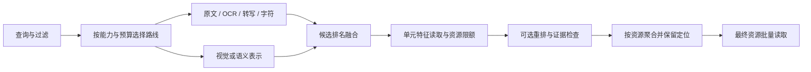

# 召回质量与多模态检索的统一演进

状态：active。先实现可运行的第一阶段；后续模型、音视频、ANN 和线上接入
分别验收，不以接口存在代替效果证据。本设计属于 Lentica 自身的本地检索架构。

M1 已实施并验收：166 项 CPU/mock 测试通过，两次 SciFact 固定对照及两次
生成图片/PDF 实验完成。实测结果见 [evaluation.md](evaluation.md)，执行记录见
[verification.md](verification.md)。M2/M3 已由 [0007](../0007-retrieval-execution/README.md)
承接并部分落地；真实多模态质量、重排、音视频、规模与完整请求时限仍在推进，
因此总规格仍为 active。

## 问题、目标与范围

现有独立层支持过滤、bounded RRF、稳定排名和最终批量取记录。SciFact 上
BM25+字符路的 Recall@10=.836944、nDCG@10=.676097；BM25 分别为
.784278/.662213，MRR 略降，nDCG 差值区间包含零。历史测试集已经看过。
当前需要同时回答：相关内容是否进入候选、为什么被排低、多模态如何定位、
每份增益花了多少资源。单纯扩大窗口或增加路线不保证改善。

目标是统一“召回→融合→候选特征→重排→资源聚合→最终记录”，保持模型和
索引可替换。检索质量、正确性、运行性能、模型质量分别提供证据。

## 核心对象与要求

- UNIT-1：建立 resource/asset（原文件）、unit（页面/区域/段落/时间段）、
  representation（原文/OCR/描述/转写/向量）三层关系。unit 和 asset 使用
  独立的非负整数 ID；locator 保存页码、归一化区域坐标或时间范围。文本证据
  带 producer/version，生成描述与原生/提取文本分开。元数据为浅拷贝只读映射。
- STAGE-1：增加可选的 StagedSearch，不改变 HybridSearch 的签名和行为。
  branch.window、candidate_window、rerank_window、最终 top_k 各自独立且有界。
  召回与融合只传 ID，特征层按候选预算读取；按候选顺序限制每资源的单元数，再重排指定前缀，尾部
  保持原顺序。重排结果必须是输入单元的完整排列，不能添加、遗漏或重复 ID。
  资源按其最佳单元顺序聚合；不按页面/帧数量求和奖励长资源。
- EVIDENCE-1：结果保存最佳命中与有限的支持单元/locator/各路贡献。严格过滤
  使用继承到单元的元数据，allowed_ids 在此接口中指 unit ID。候选读取和最终
  资源读取分别计数；有结果时最终资源仅一次批量读取。第一版提供精确标识符
  重排：只使用 native/OCR/transcript 的真实词元，不将 caption 当精确验证。
  未覆盖标识符的候选后移而非删除；无标识符时保持原顺序。这是规则实验，
  不是语义模型，也不构成完整的组合条件验证。
- DIAG-1：输出每路与并集的候选 Recall@50/100/200、独有相关命中、融合
  候选覆盖、最终 nDCG@10/Recall@10/MRR@10、逐查询遗漏阶段和类别统计。
  对照比较精确标识符重排的得失，配对 nDCG bootstrap、实际串行链路延迟、
  候选/最终读取规模。oracle nDCG 是利用标注算的候选上限，仅用于诊断，
  绝不进入检索器或重排器。
- EXPERIMENT-1：公开数据使用已有 SciFact 和已锁定选择，参数不按测试结果
  调整。受控多模态实验生成图片/PDF，并实际读取像素和原生 PDF 页面文本。
  截图 OCR 和 caption 为显式给定的合成注释，不冒充 OCR/视觉模型执行。
  固定颜色直方图仅验证可见颜色路线与融合，不代表通用视觉语义能力。
  同时报告未命中、退化、重复资源、页码定位与耗时；两次运行比较排名。
- COMPAT-1：新入口 opt-in，不改变 REST、旧 CLI、选择文件、数据库、默认模型、
  旧融合参数和原始文件。optional imports lazy；核心 python -S 可导入。
  既有公开档案和选择文件只读，报告写到显式指定的新路径。

## 演进链路

检索器和模型运行库在适配器；核心只依赖标准库。不同向量空间仅在各自适配器
内比较分数，再按排名融合。模型/权重版本、预处理和查询前缀属于空间身份。
文字与视觉维度相同不代表兼容。音视频先按时间段对齐，再验证同一时段的
复合条件；同一文件不同时间分别命中不能直接算成立。

## 实施阶段和验收

### M1：本轮落地，CPU、显式公开/合成数据

1. 实现 UNIT-1/STAGE-1/EVIDENCE-1，保留可替换 Reranker 接口。
2. 实现 DIAG-1 的独立诊断 CLI；旧 SciFact 选择只读，新增规则重排是预先固定
   的单一对照，不扫描权重。报告中保留全部退化；没有收益也不能改预期掩盖。
3. 实现 EXPERIMENT-1 的可复现实验和 CLI：文本查截图/图片、PDF 页码、精确码、
   caption 噪声和重复资源。基线为平铺单元的文本检索；同时跑多路/资源聚合，
   最后单独启用精确标识符重排。合成实验没有调参和泛化主张。
4. 跑边界/失败/排列/过滤/定位测试，完整 CPU/mock pytest、workspace、Ruff、
   格式和包导入检查；verification.md 记录实际执行与未执行事项。

### M2：语义与真实多模态质量，尚待实施

- 显式选择本地 BGE/E5 与 CLIP/SigLIP 类模型及独立环境，锁定模型工件、
  tokenizer/processor、截断、语言和设备；模型原生检索用法需单独核验。
- 实现图片或组合查询输入、真实 OCR 和复杂文档版式；必要时评估页面多向量
  检索。文本重排和多模态重排按能力选择，增加像素/token/帧数预算。
- 新建按原始文档/图片/视频来源分组的数据集：同一来源的裁剪、相邻帧、页面
  不跨开发/验证/封存测试。覆盖中文、错误码、改述、困难负例、无答案和过滤。
  查询级宏指标外，增加资源/单元 Recall、bbox IoU、时间区间 IoU、无答案误报。
- 比较当前基线、文本+语义、三路、验证胜出方案+重排。只有独立验证通过且
  成本符合显式预算才考虑产品默认；历史测试结果不决定新参数。

### M3：运行与规模，尚待实施

- 查询类型路由和按路线分配预算；同源 caption/tags 先按证据族融合，控制重复
  加分。少量可靠规则起步，学习排序需独立数据与反馈偏差处理。
- 引入持久倒排/ANN 前先测规模；过滤场景对拍同一候选域的精确检索，保留
  选择性很强时的扫描回退。保持同分规则，分别记录索引损失与相关性指标。
- 索引快照、增量新增/删除、离线构建校验、原子切换与回滚；缓存键包含
  source/filter/index/model/config 版本，不允许混用新旧向量空间。
- 并发、请求/分支时限、真实取消、允许的显式降级、资源压力与观测。
  停止等待线程不等于停止底层计算；过滤错误不可作为普通降级忽略。
- 音频先转写；声音检索按需增加。视频先字幕/镜头关键帧，动作查询另验收
  时序模型和时间对齐。缺少模态、尚未索引和运行失败分别报告。

## 所有权、迁移、失败与非目标

backend 拥有 hybrid 新增模块、评测库和新 CLI。跨模块决定见 docs/decisions/0006，
workspace.toml 链接本规格；原规格及历史证据继续有效。此阶段不接入旧照片业务
或扫描队列，不自动重建索引，不安装模型、不下载数据、不调用 GPU/云服务。

非法 locator/预算/重复单元 ID 在构造时失败；未知单元、过滤泄漏、重排结果
越界/重复/缺失均失败。重排器异常原样传播，最终存储失败保留原因并抛出
HydrationError。原检索器 strict/partial 语义继续由 HybridSearch 执行。

不把颜色匹配当视觉语义，不把合成注释当 OCR 识别，不把 mock/合成成绩当
真实模型或用户库质量，不以公开集反复挑参数，不自动切换默认或发布代码。
